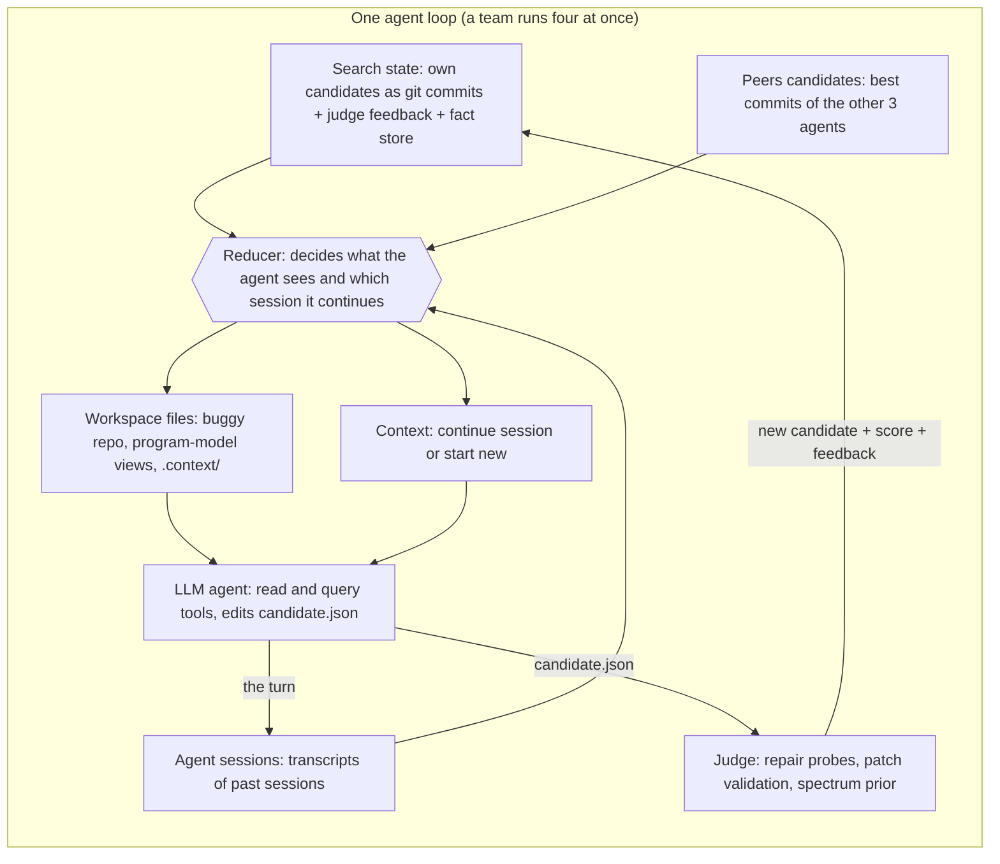

# LETHE: Development Plan

**Model-driven fault localization with teams of LLM agents that forget.**

This document is an implementation brief for a code generator (a human developer or an AI coding agent). It specifies what to build, how the parts connect, how to test each part, and how to evaluate the finished system on standard benchmarks with full logging and CSV output. It is based on two sources:

1. **The original approach**: *Scaling Discovery Requires Forgetting* (Tan et al.): teams of four agents that communicate through candidates and periodically *forget* (discard every session and the whole search state, keep only the best candidate). Its harness is Figure 3 of that paper (reducer, search state, agent sessions, filesystem state, context/session, agent, judge).
2. **The LETHE adaptation**: the same harness applied to fault localization, where the "candidate" is a *suspicion model* (a ranked set of fault hypotheses over a program model), the judge is a *repair-based verifier*, and what survives a forget is the best candidate plus verified facts.

A reference prototype (a toy `shop` program, about 600 lines of Python) exists in `lethe_demo.zip`. Treat it as a behavioural reference for Milestone M1, not as production code.

---

## 0. Instructions to the code generator

**Build in the order of the milestones in Section 9.** Do not start a milestone until the previous milestone's acceptance tests pass.

**Conventions**

- Python 3.11+, fully type-annotated, `mypy --strict` clean on `lethe/`; `ruff` for lint and format.
- `pydantic` v2 for every schema that crosses a file or process boundary. `typer` for CLIs. `asyncio` for agent loops. `pytest` for tests.
- Subprocesses (git, test runners, compilers) go through one wrapper, `lethe/core/proc.py`, which enforces timeouts, resource limits and output capture.
- No global state. Every run is described by one immutable `RunConfig` and writes to one run directory.
- Every function that costs money or time (LLM call, judge probe, test execution) emits a structured log event (Section 7.5).
- Where a benchmark tool's exact behaviour is uncertain (marked **VERIFY**), implement it behind the adapter interface, document the assumption in `docs/assumptions.md`, and add a smoke test. Do not silently guess.

**Hard rules**

1. **No ground-truth leakage.** Ground truth (fixed code, fix patch, faulty locations) is used only by `evaluation/`. Nothing under `lethe/` may import from `evaluation/`. The agent workspace must never contain the fixed version, the fix patch, or VCS history that reveals them (Section 5.7.1 and the leak test in Section 8).
2. **Every configuration is a reducer setting** run by the same harness (as in the paper). Do not write separate loops for "single", "parallel", "team" and "forgetting".
3. **Equal budgets.** All configurations in a comparison get the same dollar budget per replicate.
4. **Deterministic where possible, reproducible always.** Seeds, model ids, prompt hashes, tool versions and config snapshots go into each run's manifest.
5. **Do not invent benchmark data or results.** Evaluation scripts read real benchmark checkouts and real run logs only.

---

## 1. The original approach, and how LETHE maps onto it

### 1.1 What the paper does

- **Autoresearch loop.** An agent proposes a candidate, a judge scores it, the agent uses the score and feedback for the next proposal.
- **Two kinds of history.** The *search state* (every candidate with score and feedback) and the *session* (the messages and reasoning that produced them). Both accumulate, and the agent becomes anchored: edits shrink, reasoning shrinks, and the agent stops converting ideas into experiments.
- **Forgetting.** The search is divided into rounds. At each round boundary every session and the whole search state are discarded; only the best candidate and its score are kept. A new agent with an empty context, and the same first-turn instructions as in round 1, starts from it.
- **Teams.** Four agents run in parallel, each with its own session and search state. Before each proposal, every agent can read its peers' candidates (commits with scores). Communication is asynchronous, file-based and token-free. There is no orchestrator.
- **Reducer.** The central harness component. It reads the agent's search state and sessions, and decides (a) which candidates appear as files in the workspace and (b) which session the agent continues. Every compared configuration is one reducer setting.
- **Protocol details worth copying.** Agent edits files only; it does not evaluate its own work; the harness commits the working tree, runs the judge, and invokes the agent again with the result. The first turn of a session gets the full task message; later turns get only a short status update. The paper's team forgets three times (four equal rounds), with three replicates per configuration and equal spend across configurations.

### 1.2 Figure 3 to LETHE component map



| Paper component (Figure 3) | LETHE component | Where specified |
|---|---|---|
| Candidate (code, scores, feedback) | **Suspicion candidate**: ranked fault hypotheses over the program model, plus optional patch, plus judge feedback | 4.3, 5.6 |
| Search state (own candidates) | Append-only git repository per agent; one commit per candidate | 5.7.2 |
| Peers' candidates | Files under `.context/peers/branch<i>/` | 5.7.4 |
| Agent sessions | JSONL transcripts per session | 5.7.3 |
| Reducer | `harness/reducer.py` | 5.7.5 |
| Filesystem state | Agent workspace (buggy repo, model views, `.context/`) | 5.7.1 |
| Context/Session | Continue-or-new decision plus first-turn or later-turn message | 5.7.5, 5.8 |
| Agent | Tool-using LLM loop with read and query tools | 5.8 |
| Judge | Repair-based verifier with a scalar score | 5.6 |
| Forget | `harness/forget.py` policies | 5.7.6 |

### 1.3 What LETHE changes relative to the paper (design decisions)

| # | Paper | LETHE | Reason |
|---|---|---|---|
| D1 | Candidate is code; agent edits code | Candidate is a **ranked hypothesis file** (`candidate.json`) plus an optional patch | Fault localization outputs locations, not programs |
| D2 | Judge is a task score (cycles, points) with ground-truth-like objective | Judge is a **proxy verifier** with no access to ground truth: repair probes, patch validation, spectrum prior | A real debugging session has no oracle for the fault location. This is the main research risk |
| D3 | Keep only the best candidate | **Configurable memory policy**: `candidate_only` (paper-faithful) or `candidate_plus_facts` (best candidate plus judge-verified facts such as "exonerated" or "confirmed") | The paper lists "what to remember" as future work. Facts are state, not narrative |
| D4 | Fixed forgets (3 forgets, 4 rounds) | Fixed schedule **and** plateau-triggered policy | The paper lists "when to forget" as future work |
| D5 | Agents are homogeneous | Optional **views** per agent (structural, data-flow, history, behavioural) | The paper notes communication homogenizes proposals; views counter this |
| D6 | Agent has file tools | File tools plus **model query tools** (slice, callers, coverage-of). **No execution of the project** by default | Keeps the judge as the only source of truth and keeps runs comparable |
| D7 | Budget in dollars | Dollars for LLM spend **plus** reported judge time | Mutation probing is a large non-LLM cost and must be visible |
| D8 | Score improves monotonically in the objective | Judge score is a proxy, so **judge-versus-truth calibration is itself an evaluated result** | See RQ4 |

---

## 2. Product definition

**Goal.** Given a buggy project, its test suite, and at least one failing test, output a ranked list of suspicious program elements (methods and statements) with evidence, optionally with a candidate repair at the top location.

**Primary users.** Researchers evaluating LLM-based fault localization; developers wanting a debugging assistant.

**Non-goals (v1).** Multi-fault localization beyond reporting several ranked hypotheses; fixing bugs as the product goal (patches are used as evidence only); IDE integration; languages other than Python and Java.

**Supported targets (v1).** Python (pytest) and Java (Maven or Ant via Defects4J). The language-specific parts live behind adapters (Section 5.1).

**Inputs.** Project checkout, test command(s), list of failing tests, configuration file.
**Outputs.** `localization.json` (ranked elements with scores and evidence), `report.md` (model-to-text), full run logs.

---

## 3. Architecture and repository layout

```text
lethe/                              # the tool (no benchmark-specific code)
  pyproject.toml
  README.md
  docs/                             # architecture.md, assumptions.md, config.md, prompts.md
  lethe/
    core/        types.py ids.py config.py proc.py logging.py budget.py hashing.py
    models/      metamodel.py program_model.py trace_model.py suspicion.py
                 candidate.py facts.py diff.py views.py serialization.py
    adapters/    base.py python_pytest.py java_defects4j.py   # build / run tests / checkout
    extract/     python_ast.py java_treesitter.py             # code -> program model
    coverage/    python_coveragepy.py java_spectra.py         # tests -> trace model
    spectrum/    formulas.py                                  # ochiai, dstar, tarantula, ...
    mutation/    engine.py sampler.py ops_python.py ops_java.py
    judge/       base.py fixprobe.py patch_validation.py spectrum_prior.py
                 scoring.py cache.py
    harness/     workspace.py search_state.py sessions.py reducer.py peers.py
                 forget.py team.py runner.py snapshot.py ranking.py
    agent/       llm/{base,anthropic,openai_compat,mock}.py tools.py loop.py
                 prompts/{task.md,first_turn.md,later_turn.md,views/*.md}
    report/      markdown.py json_out.py
    cli.py
  tests/                            # unit, integration, golden, leak tests
  fixtures/shop/                    # the toy program from the prototype
evaluation/                         # everything used to evaluate LETHE (Section 7)
docker/                             # images for Python and Java toolchains
Makefile
```

Rules: `lethe/` never imports `evaluation/`; `evaluation/` imports `lethe/` as a library and through its CLI.

---

## 4. Data models and schemas

All models are pydantic classes with `schema_version`, serialized to JSON, stored in a content-addressed cache, and diff-able.

### 4.1 Program model

```text
ProgramModel
  language, root, source_hash
  components[]  : id (file path), functions[]
  functions[]   : id "path::Class.method" or "path::func", name, class_name,
                  start_line, end_line, calls[] (function ids), statements[]
  statements[]  : id "path:LINE", lineno, text, function_id, kind
```

Extraction rules: every statement node inside a function body (skip docstrings, comments, imports); call edges by name resolution (best effort; unresolved calls are recorded, not guessed). Statement identity is `file:line` (first line for multi-line statements).

### 4.2 Trace model

```text
TraceModel
  tests[]     : id, outcome (pass | fail | error | skipped), duration, failure_message, stack_trace
  covers      : test_id -> set[statement_id]
  failing_slice: set[statement_id]      # union of coverage of failing tests
```

### 4.3 Candidate (the thing the agent edits)

`candidate.json`:

```json
{
  "schema_version": "1",
  "hypotheses": [
    {"rank": 1, "element": "src/pricing.py::loyalty_rate", "granularity": "method",
     "rationale": "free text, at most 500 chars"},
    {"rank": 2, "element": "src/pricing.py:3", "granularity": "statement",
     "rationale": "..."}
  ],
  "notes": "free text carried in the candidate (not used for scoring)"
}
```

Constraints (validated by the harness before judging): at most `K` hypotheses (default 10); every `element` must exist in the program model; ranks are 1..n without gaps; at most one hypothesis per element. Invalid entries are dropped and reported in feedback (with a score penalty, Section 5.6.4).

Optional `patch.diff`: a unified diff the agent believes repairs the fault at the top hypothesis (used by the `patch_validation` signal).

### 4.4 Judge feedback (`feedback.json`, written by the harness next to each candidate)

```json
{
  "candidate_id": "c-0007", "score": 0.81,
  "components": {"fix_rank_score": 0.70, "progress_score": 0.10, "spectrum_prior": 0.01},
  "per_hypothesis": [
    {"rank": 1, "element": "...::loyalty_rate", "probe": "fixed",
     "mutants_run": 24, "best_pass": 12, "total_tests": 12,
     "fixing_edits": ["line 3: Gt -> GtE"], "patch_valid": null}
  ],
  "dropped": [{"element": "no.such.fn", "reason": "unknown_element"}],
  "cost": {"judge_seconds": 4.1, "test_executions": 288, "cache_hits": 0}
}
```

### 4.5 Fact store (memory policy `candidate_plus_facts`)

```text
Fact: element_id, kind (exonerated | confirmed | inconclusive), evidence_ref (probe id),
      source_agent, round, mutants_run
```

Facts are *judge-produced only*. Agents never write facts, which keeps them free of narrative.
Rule: `inconclusive` is recorded when an element has zero applicable mutation sites or all mutants timed out. It is never treated as exonerating.

### 4.6 Run directory layout (one per run)

```text
runs/<exp_id>/<bug_id>/<config_name>/rep<k>/
  manifest.json            # config snapshot, versions, seeds, prompt hashes, image digests
  events.jsonl             # all structured events (Section 7.5)
  agents/agent<i>/
    search_state.git/      # append-only candidate commits
    sessions/session<j>.jsonl
  judge/probes.jsonl       # every probe with full detail
  localization.json        # final ranking (completed, Section 5.9)
  report.md
  cost.json
```

---

## 5. Component specifications

### 5.1 Adapters (language and benchmark plumbing)

```python
class ProjectAdapter(Protocol):
    language: str
    def checkout(self, spec: BugSpec, dest: Path) -> Path: ...       # buggy version, NO fix/VCS leakage
    def build(self, root: Path) -> BuildResult: ...
    def list_tests(self, root: Path) -> list[TestId]: ...
    def run_tests(self, root: Path, tests: list[TestId] | None, timeout_s: int) -> TestRun: ...
    def failing_tests(self, root: Path) -> list[TestId]: ...
    def apply_overlay_and_run(self, root: Path, overlay: SourceOverlay,
                              tests: list[TestId], timeout_s: int) -> TestRun: ...  # fast mutant execution
```

- **`python_pytest`**: runs pytest in a per-project virtualenv; parses JUnit XML. Overlay execution copies the tree (or uses a bind-mounted overlay) and replaces one file.
- **`java_defects4j`**: wraps the Defects4J CLI (`checkout`, `compile`, `test`). **VERIFY**: the exact CLI flags and version in the Docker image; whether checkouts contain a git history with fixed-version tags (strip or re-initialise VCS in the agent workspace).
- **Fast mutant execution for Java** (needed for the judge to be affordable): compile only the mutated source file with `javac` against the already-compiled class directory and the project classpath, output to a temporary overlay directory placed first on the classpath, and run only the selected tests with the JUnit console runner. Fall back to a full `compile` if single-file compilation fails.
- **Fail-fast test ordering** (all adapters): run the failing tests first; stop at the first regression; run the remaining tests only if all originally failing tests pass.

### 5.2 Extraction (code to program model)

- Python: `ast`. Java: `tree-sitter` (py-tree-sitter + tree-sitter-java). Both implement `extract(root, adapter) -> ProgramModel`.
- Golden tests: extraction output for `fixtures/shop` must equal the prototype's counts (3 components, 12 functions, 33 statements).

### 5.3 Coverage and trace model

- Python: `coverage.py` with per-test contexts (`--context` / dynamic contexts), or one execution per test as a fallback.
- Java: per-test statement coverage through a spectra tool behind `CoverageProvider` (**VERIFY**: GZoltar or FLACOCO versions that work with the project's Java version). If a provider fails for a bug, the bug is marked `excluded: no_spectra` in the bug table, not silently dropped.
- Output: `TraceModel`; cached under `evaluation/data/precomputed/<bug_id>/` (Section 7.2).

### 5.4 Spectrum formulas

Implement Ochiai (default), DStar (`*`=2 and 3), Tarantula, Barinel, Op2. Pure functions over `(ef, ep, nf, np)`; unit tested against hand-computed values. Tie policy is configurable (`average` default, `worst`, `best`) and used consistently by baselines and by LETHE's ranking completion.

### 5.5 Mutation engine (used by the judge)

- **Operators v1 (both languages)**: relational operator replacement (`> >= < <= == !=`), arithmetic operator replacement, logical operator replacement, constant change (`c+1, c-1, 0, 2c, c/2, negate`), condition negation, boundary shift, unary/increment flip, return-constant replacement, statement deletion (guarded; excluded for declarations).
- **Operators v2 (later)**: variable swap among same-typed in-scope names (needs types; Java first), call-argument swap, off-by-one in index expressions.
- **Sampler**: for an element with many mutation sites, sort sites by spectrum score and cap at `max_mutants_per_element` (default 60, deterministic order). The sampler's cap and seed are logged. If the cap truncates, the probe result carries `truncated=true` and **must not** be used to exonerate (it becomes `inconclusive`).
- Each mutant has a stable id: `sha256(file_hash, line, operator, site_index, variant)`.
- Mutants that fail to compile, or time out, are counted and logged separately.

### 5.6 Judge

The judge scores a candidate **without ground truth**. It is pluggable: a list of *signals* combined by a scoring function.

```python
class Signal(Protocol):
    name: str
    def evaluate(self, hyp: Hypothesis, ctx: JudgeContext) -> SignalResult: ...

class Judge:
    def evaluate(self, candidate: Candidate, patch: str | None) -> JudgeResult: ...
```

#### 5.6.1 Signal `fixprobe` (core)

For a hypothesis element `e`: apply each sampled single-edit mutant inside `e`, run the suite (fail-fast order), and record `best_pass`. `fixed = any mutant makes all tests pass`.
`fixed=false` with `mutants_run > 0` and `truncated=false` means **exonerated under a single-fault, single-edit assumption**. Zero sites or truncation means **inconclusive**.

#### 5.6.2 Signal `patch_validation` (optional, default on in the full configuration)

If the candidate contains `patch.diff` that touches the top hypothesis' method, apply it in an overlay and run the suite. `patch_valid = all originally failing tests pass and no regressions`. This is *evidence*, not proof of the fault location (patches can overfit); that is why RQ4 measures calibration.

#### 5.6.3 Signal `spectrum_prior` (small weight)

Percentile of the top hypotheses in the spectrum ranking. Prevents wholly arbitrary candidates from scoring on noise.

#### 5.6.4 Scalar score (config-driven weights, defaults shown)

Let `h_1..h_n` be the valid hypotheses in rank order, `N` the number of tests, `base_pass` the number passing on the buggy version, and `p_i = (best_pass_i - base_pass) / (N - base_pass)` clipped to [0, 1].

```text
r*        = min{ i : fixed_i or patch_valid_i }       (undefined if none)
S_fix     = 1 / r*                                     (0 if r* undefined)
S_prog    = max_i ( p_i / i )
S_spec    = mean spectrum percentile of the top 3 hypotheses
penalty   = 0.05 * (number of dropped invalid hypotheses), at most 0.2

S = clip( 0.70*S_fix + 0.25*S_prog + 0.05*S_spec - penalty, 0, 1 )
```

Weights live in config and are *not tuned on the evaluation bugs* (they may be calibrated on the pilot set only, Milestone M7). Best-candidate selection uses `S`; ties break by fewer hypotheses, then earlier commit.

#### 5.6.5 Caching and cost accounting

- Cache key: `sha256(source_hash_of_project, element_id, operator_set_version, sampler_config, test_set_hash)`.
- On a cache hit, the log still records the *original* runtime and test executions with `cache_hit=true`, so cost comparisons between configurations stay fair.
- Judge time is reported separately from LLM dollars (decision D7).

#### 5.6.6 Judge safety

All mutant execution runs in a container, with CPU and memory limits and a hard timeout per mutant. A judge crash is an event, never a silent zero score.

### 5.7 Harness

#### 5.7.1 Workspace (what an agent sees)

```text
workspace/                       # fresh directory per turn plan, rebuilt by the reducer
  TASK.md                        # constant task description (Appendix A)
  repo/                          # buggy project, READ-ONLY, no VCS history, no fix artifacts
  model/                         # rendered program-model views (components, functions, call graph)
  candidate.json                 # the file the agent edits (seeded from the best candidate)
  patch.diff                     # optional, agent-written
  .context/
    failing_tests.md             # test ids, assertion messages, stack traces
    slice.json                   # failure slice
    suspicion.json               # spectrum scores (+ facts if memory policy includes them)
    feedback/                    # judge feedback for this agent's candidates (policy-limited)
    lineage.md                   # candidate lineage (empty after a forget)
    peers/branch<i>/             # peers' best candidate + feedback (team only)
```

Write permissions: the agent may write only `candidate.json`, `patch.diff` and `notes/`. Reads and writes outside `workspace/` are refused by the tool layer.

#### 5.7.2 Search state (per agent, append-only)

A git repository per agent. Every judged candidate is one commit containing `candidate.json`, `patch.diff` (if any) and `feedback.json`. The commit message carries `score=<S>`. History is never rewritten; a forget starts a **new** repository seeded with the best candidate, which keeps the "search state is discarded" semantics literal.

#### 5.7.3 Sessions

Each session is a JSONL transcript of messages and tool calls. The harness keeps every past session on disk (for analysis) but only exposes the *current* one to the agent. A session has: `session_id`, `agent_id`, `round`, `turn_index`.

#### 5.7.4 Peers (communication)

Before every turn of agent *a* the reducer copies each peer's current best candidate and its feedback into `.context/peers/branch<i>/`. Communication is asynchronous (the agent sees whatever is committed at turn start) and costs no tokens. No point-to-point messaging, no orchestrator. Peers' candidates are visible both before and after a forget (as in the paper).

#### 5.7.5 Reducer (the core abstraction)

```python
@dataclass(frozen=True)
class ReducerConfig:
    n_agents: int                  # 1 or 4
    share_peers: bool              # team communication
    memory: Literal["candidate_only", "candidate_plus_facts", "none"]
    show_history: Literal["own_all", "own_best_only"]
    views: list[str] | None        # per-agent view names, or None for homogeneous agents
    granularity_schedule: list[str]  # e.g. ["method", "statement"] across rounds

@dataclass
class TurnPlan:
    session_action: Literal["continue", "new"]
    message: str                   # first-turn message or short status message
    workspace: WorkspaceSpec       # which files to materialize
    round: int

class Reducer(Protocol):
    def plan_turn(self, agent_id: int, state: TeamState) -> TurnPlan: ...
```

Paper-faithful semantics:

- `single` and `parallel4`: `share_peers=False`; each agent continues its latest session and sees only its own candidates.
- `team4`: `share_peers=True`; sessions continue.
- `lethe` (team with forgetting): `share_peers=True` and the forget policy (5.7.6) swaps every agent to a fresh search state and a `new` session at round boundaries.

#### 5.7.6 Forget policies

```python
class ForgetPolicy(Protocol):
    def should_forget(self, state: TeamState) -> bool: ...

def forget(team: TeamState, memory: str) -> ForgetRecord:
    best = argmax over all agents' candidates of judge score
    facts = union of all agents' facts if memory == "candidate_plus_facts" else empty
    for agent in team.agents:
        agent.search_state = new_repo(seed=best, facts=facts)   # old repo archived, not visible
        agent.session = None                                    # next turn is a first turn
    return ForgetRecord(carried_candidate=best.id, carried_facts=len(facts), ...)
```

Policies:

- `never`: baseline.
- `fixed(R)`: R equal-spend rounds, so R-1 forgets at spend fractions k/R (paper default R=4).
- `plateau(W, eps)` (extension): forget when, over the last `W` team turns, the best score improved by less than `eps` **and** the Jaccard similarity of consecutive top-5 element sets is above a threshold, or the median model-delta size (Section 7.6) fell below a floor. All thresholds are config values and are logged with every decision.

Round boundaries are synchronous: when team spend crosses the threshold, the harness stops launching new turns, waits for in-flight turns to finish (with a timeout), runs the judge on them, then forgets.

#### 5.7.7 Budget

`BudgetMeter` converts provider-reported usage to dollars using a price table in config (input, output, reasoning, cache-read, cache-write). Parallel agents split the total budget equally (as in the paper). Teams share one team budget. The meter writes `budget_update` events. A hard cap stops the run even mid-round.

#### 5.7.8 Snapshot and fork (needed for RQ6)

`RunSnapshot.create(team_state)` stores search states, sessions, budget and RNG state; `fork(snapshot, mode="continue" | "forget")` resumes from the same plateaued state either way. This reproduces the paper's "continue or forget from the same state" experiment.

#### 5.7.9 Concurrency

One asyncio task per agent. The judge runs in a bounded worker pool shared by agents, with the cache in front. A run is resumable: on restart, the harness rebuilds `TeamState` from `events.jsonl` and the git states and continues.

### 5.8 Agent runtime

- **LLM client interface**: `complete(messages, tools, system, max_tokens, temperature) -> Completion(content, tool_calls, usage{input, output, reasoning, cache_read, cache_write}, model, latency)`. Implementations: `anthropic`, `openai_compat` (also covers local servers), `mock` (scripted, deterministic; used by all tests).
- **Tools** (JSON-schema tool definitions): `read_file(path, start?, end?)`, `list_dir(path)`, `grep(pattern, path?)`, `query_model(kind, arg)` where `kind ∈ {callers, callees, covered_by, statements_of, slice_between}`, and `write_candidate(json)` / `write_patch(diff)`. No shell, no test execution, no network, unless `allow_execute: true` (default false; if enabled, every execution is logged and counted in cost).
- **Turn loop**: reducer plan, materialize workspace, send message (first-turn message if `session_action == new`, else short status), run tool loop until the agent ends the turn or hits `max_tool_calls_per_turn`, collect `candidate.json`, validate, judge, commit, log. A turn with no changed candidate is an **empty turn** and is logged as such (the paper reports empty turns as a symptom of stalled sessions).
- **Prompts**: Appendix A. The prompts describe the task and the loop only; they give no search strategy. Prompt files are hashed into the manifest.

### 5.9 Final ranking and report

The final answer is the best candidate (by judge score) across all agents. To compute ranking metrics that need a full ranking (MAP, EXAM), **the hypothesis list is completed with a spectrum-ordered tail** of all remaining elements. The same completion is applied to every LLM configuration, and SBFL baselines use the spectrum ranking directly, so comparisons are fair. Both the raw hypothesis list and the completed ranking are stored (`source: hypothesis | spectrum_tail`).

Granularity handling: method-level hypotheses are expanded to their statements ordered by spectrum score within the method; statement-level hypotheses are lifted to their methods for method-level metrics.

`report.md` is a model-to-text rendering: confirmed locations with evidence and candidate repairs, exonerated elements, inconclusive elements, and the lineage of the winning candidate.

### 5.10 CLI

```text
lethe extract   --project PATH --out MODEL.json
lethe trace     --project PATH --out TRACE.json
lethe localize  --project PATH --config CONFIG.yaml --out RUNDIR
lethe report    --run RUNDIR
lethe replay    --run RUNDIR --from-event N --mode continue|forget      # uses snapshots
```

Example `RunConfig`:

```yaml
run:
  name: lethe
  budget_usd: 2.00
  seed: 1
agents: {n: 4, model: "<provider-model-id>", temperature: 1.0, max_tool_calls_per_turn: 40}
reducer: {share_peers: true, memory: candidate_plus_facts, show_history: own_all, views: null,
          granularity_schedule: [method, statement]}
forget: {policy: fixed, rounds: 4}
judge: {signals: [fixprobe, patch_validation, spectrum_prior],
        weights: {fix: 0.70, progress: 0.25, spectrum: 0.05},
        max_mutants_per_element: 60, mutant_timeout_s: 30, top_k: 10}
prices: {input_per_mtok: 0.0, output_per_mtok: 0.0, reasoning_per_mtok: 0.0}   # fill from provider
```

---

## 6. Experimental configurations (all are reducer settings)

| Config name | Agents | Peers | Forget | Memory | Budget handling | Corresponds to |
|---|---|---|---|---|---|---|
| `single` | 1 | no | never | n/a | whole budget | Paper: "1 agent" |
| `parallel4` | 4 | no | never | n/a | split 4 ways | Paper: "4 parallel agents" |
| `team4` | 4 | yes | never | n/a | shared | Paper: team before forgetting |
| **`lethe`** | 4 | yes | fixed, 4 rounds | `candidate_plus_facts` | shared | LETHE (full) |
| `lethe_candidate_only` | 4 | yes | fixed, 4 rounds | `candidate_only` | shared | Paper-faithful forgetting (ablation) |
| `lethe_views` | 4 | yes | fixed, 4 rounds | `candidate_plus_facts` | shared | Per-agent views (D5) |
| `lethe_plateau` | 4 | yes | plateau | `candidate_plus_facts` | shared | Adaptive forgetting (D4) |
| `lethe_raw` | 4 | yes | fixed, 4 rounds | `candidate_plus_facts` | shared | No program-model files; agents see only repo and failing tests |
| `lethe_fixprobe_only` | 4 | yes | fixed, 4 rounds | `candidate_plus_facts` | shared | Judge without `patch_validation` |
| `lethe_spectrum_judge` | 4 | yes | fixed, 4 rounds | `candidate_only` | shared | Judge using only `spectrum_prior` (judge-quality ablation) |
| `oneshot_llm` | 1 | no | n/a | n/a | one call | Simple LLM baseline, no judge |
| `sbfl_*`, `mbfl_*` | n/a | n/a | n/a | n/a | no LLM | Classical baselines (Section 7.4) |

---

## 7. The `evaluation/` directory

Purpose: everything needed to evaluate LETHE on benchmarks, collect comprehensive logs, and produce CSV files, statistics, figures and tables. **All evaluation code lives here; `lethe/` stays benchmark-agnostic.**

### 7.1 Layout

```text
evaluation/
  README.md                         # how to reproduce every result, step by step
  Makefile                          # make pilot | main | ablations | rq6 | analysis | all
  requirements-eval.txt             # pandas, numpy, scipy, statsmodels, matplotlib, pyyaml, jsonschema, tqdm
  configs/
    benchmarks/   toy_shop.yaml defects4j.yaml bugsinpy.yaml gitbug_java.yaml   # optional: contamination-resistant set (VERIFY availability)
    experiments/  pilot.yaml main.yaml ablation_memory.yaml ablation_judge.yaml
                  ablation_views.yaml ablation_raw.yaml forget_policy.yaml same_state.yaml
    models/       <model-name>.yaml           # provider, model id, prices, temperature
  docker/
    Dockerfile.java_defects4j  Dockerfile.python_bugsinpy  compose.yaml
  benchmarks/
    setup_defects4j.sh  setup_bugsinpy.sh  setup_gitbug_java.sh
    list_bugs.py          # enumerate bugs with metadata -> data/bugs.csv
    verify_bug.py         # fails on buggy, passes on fixed, flakiness check (N reruns)
    ground_truth.py       # faulty methods/statements from the fix patch (Section 7.3)
    select_subset.py      # filters + seeded stratified sampling -> data/subsets/<name>.txt
    checkout_bug.py       # clean workspace without fix or VCS leakage
    precompute.py         # build, trace, spectra, program model per bug -> data/precomputed/
  baselines/
    sbfl.py               # ochiai, dstar2, dstar3, tarantula, barinel, op2 -> ranking CSVs
    mbfl.py               # Metallaxis-style and MUSE-style using lethe.mutation (VERIFY definitions in docs)
    oneshot_llm.py        # single LLM call, no judge, same ranking completion
  runners/
    run_experiment.py     # grid: bugs x configs x replicates; parallel jobs; resumable
    run_single_bug.py     # one cell of the grid (used inside containers)
    sweep.py              # expands experiment YAML into a job list (jobs.jsonl)
    estimate_cost.py      # pre-run dollar and judge-time estimate; --dry-run with mock LLM
    docker_runner.py      # starts a container per bug, mounts data and results
  metrics/
    metrics.py            # top_n, ap, rr, exam, first_rank, wasted_effort
    ranking_completion.py # hypothesis list + spectrum tail
    anytime.py            # best-so-far candidate at spend checkpoints
  analysis/
    collect_logs.py       # runs/*/events.jsonl -> CSVs (Section 7.7)
    aggregate.py          # per-config summaries
    stats.py              # paired tests, effect sizes, bootstrap CIs
    anchoring.py          # session-length narrowing analysis (RQ1)
    judge_calibration.py  # judge score vs truth (RQ4)
    plots.py              # figures (PDF and PNG)
    latex_tables.py       # LaTeX tables from CSVs
    make_report.py        # results/<exp>/evaluation_report.md
  experiments/
    rq1_anchoring.py  rq2_effectiveness.py  rq3_ablations.py
    rq4_judge_quality.py  rq5_forget_policy.py  rq6_continue_vs_forget.py
  schemas/
    events.schema.json  runs.schema.json  turns.schema.json  rounds.schema.json  ...
  tools/
    validate_logs.py      # validates every run directory against schemas
    leak_check.py         # scans agent workspaces for fix/VCS leakage (Section 8)
    redact_secrets.py     # strips API keys and absolute paths from logs before sharing
  data/                   # gitignored: bugs.csv, subsets/, precomputed/
  results/                # gitignored: <exp_id>/{runs,csv,figures,tables,evaluation_report.md}
  tests/                  # unit tests for metrics, ground truth, stats, collectors
```

### 7.2 Benchmarks

| Benchmark | Language | Role | Notes |
|---|---|---|---|
| Toy `shop` (from prototype) | Python | Smoke and pilot | Fast, deterministic, with scripted agents |
| BugsInPy | Python | Main Python benchmark | Per-project environments; the Docker image builds one venv per project (**VERIFY** supported Python versions) |
| Defects4J | Java | Main Java benchmark | Standard in FL research; counts come from `list_bugs.py`, not from this document |
| GitBug-Java (optional) | Java | Contamination-resistant check | Newer bugs; **VERIFY** availability and licence |

**Bug filtering** (config-driven, logged to `bugs.csv`): reproducible failure (fails on buggy, passes on fixed, stable across `N` reruns, default 5); at least one failing test; spectra obtainable; single-fault proxy filter (the fix touches one method, configurable); exclude bugs whose fix changes only test files or non-source files. Excluded bugs keep a row with `included=false` and an `exclude_reason`.

**Sampling.** Full benchmarks are too expensive for LLM runs at 3 replicates and 10 configurations. `select_subset.py` draws a seeded, stratified sample (by project and by difficulty proxy such as number of covered statements) and writes the bug list under `data/subsets/`. The seed and filters are part of the experiment manifest. Report subset results and, for the cheap non-LLM baselines, results on the full filtered set.

**Precompute step.** `precompute.py` builds each bug once and stores the program model, trace model, spectra and baseline rankings, so LLM runs only pay for agent turns and judge probes.

### 7.3 Ground truth

`ground_truth.py` derives faulty locations from the fix patch (buggy to fixed). Conventions, fixed **before** any experiment is run and not changed afterwards:

- Faulty statements: lines removed or modified in source files in the buggy version. Ignore test files, comments-only changes, imports and formatting-only changes.
- **Omission faults** (hunks that only add lines): by default, the statement immediately following the insertion point is faulty (`omission_policy: next_statement`; alternatives `previous_statement`, `enclosing_method_only` for sensitivity analysis).
- Faulty methods: the methods containing any faulty statement (or the insertion point).
- Bugs with ambiguous or unmappable ground truth are marked `gt_quality: ambiguous` and reported both included and excluded.

Ground truth is stored in `data/ground_truth/<bug_id>.json` and is read only by `evaluation/metrics` and `evaluation/analysis`.

### 7.4 Baselines

- **SBFL**: Ochiai, DStar (2 and 3), Tarantula, Barinel, Op2 on the precomputed spectra. Output: full rankings as CSV plus metrics.
- **MBFL**: a Metallaxis-style and a MUSE-style variant built on `lethe.mutation` (document the exact formulas in `docs/baselines.md` and **VERIFY** them against the original papers before use).
- **LLM baselines** are harness configurations (`single`, `parallel4`, `team4`) plus `oneshot_llm` (one call, no judge, ranking completed with spectrum tail).
- Optional: re-run externally published LLM-based FL tools where artifacts are available, clearly separated from the in-harness baselines.

### 7.5 Logging

Every run writes `events.jsonl`, one JSON object per line, validated against `schemas/events.schema.json`. Common fields on every event: `schema_version, ts, run_id, seq, event, agent_id?, round?`.

| Event | Key payload |
|---|---|
| `run_start` | full config snapshot, versions, seeds, image digest, prompt hashes, bug metadata (no ground truth) |
| `round_start` / `round_end` | round index, spend, best score, team state hash |
| `turn_plan` | reducer decision: session action, files materialized, peers visible (candidate ids), history policy |
| `llm_call` | model, tokens in/out/reasoning/cache, latency, cost, finish reason |
| `tool_call` | tool, args hash, bytes returned, duration |
| `candidate_committed` | candidate id, commit hash, n hypotheses, edit distance to previous candidate, empty-turn flag |
| `judge_start` / `judge_end` | candidate id, signals, probes run, cache hits, test executions, seconds, score and components |
| `probe` | element, mutants run, compile failures, timeouts, truncated flag, fixed, best pass, fixing edits |
| `peer_read` | which peer candidates were exposed, and which elements the agent later adopted |
| `forget` | policy and trigger values, carried candidate id, carried facts count, discarded sessions and commits (counts) |
| `budget_update` | spend by category, remaining |
| `snapshot` / `fork` | snapshot id, mode |
| `error` | type, component, recoverable flag |
| `run_end` | status (`completed`, `budget`, `error`, `timeout`), final ranking id, totals |

Raw material kept for deep analysis: full session transcripts, every candidate commit with feedback, every probe record.

### 7.6 Metrics (defined in `metrics/metrics.py`)

Evaluated at **method level** and **statement level**. A bug may have several faulty elements.

- **Top-N (N = 1, 3, 5, 10)**: 1 if at least one faulty element appears in the top N of the completed ranking, else 0; averaged over bugs (reported as count and percentage).
- **First rank** (rank of the first faulty element) and **MFR** (mean first rank).
- **MRR**: mean of `1 / first_rank`.
- **AP and MAP**: average precision over all faulty elements.
- **EXAM**: `first_rank / total_elements`, where total elements = executable statements (statement level) or methods (method level) in the program model. Report also the slice-relative variant.
- **Ties**: handled by the configured tie policy (default `average`).
- **Cost metrics**: LLM dollars, tokens (in, out, reasoning), number of turns, judge seconds, judge test executions, wall time.
- **Efficiency metrics**: spend and proposals until first confirmed fix, until first correct Top-1, and until final best candidate.
- **Anytime metrics** (`anytime.py`): at spend checkpoints (default every 5% of budget), take the candidate with the best *judge* score so far, complete its ranking, and compute Top-N. This yields the analogue of the paper's "best score vs dollars" figure, using the judge's choice, not ground truth.
- **Anchoring indicators** (RQ1, from turns): *model-delta size* (insertions + deletions + rank moves between consecutive candidates of the same agent, the analogue of "lines changed per proposal"); reasoning tokens per turn; empty-turn rate; fraction of proposals in the same component as the previous proposal; repeated-element rate; count of never-before-proposed elements per turn.
- **Judge quality** (RQ4): Spearman correlation between judge score and correctness of the candidate's top hypothesis; AUC for "judge score predicts Top-1 hit"; wrongly-exonerated rate (faulty element probed with `fixed=false` and not truncated); confirmed-but-wrong rate (a fix confirmed at a non-faulty element).

### 7.7 CSV outputs (written by `analysis/collect_logs.py` into `results/<exp_id>/csv/`)

All CSVs are UTF-8, comma-separated, with a header, one tidy row per unit, and a `schema_version` column. Column lists below are the contract the collectors must satisfy.

**`bugs.csv`**: `bug_id, benchmark, project, version, language, loc, n_tests, n_failing_tests, n_faulty_methods, n_faulty_statements, fix_hunks, has_omission, flaky, included, exclude_reason, gt_quality, contamination_risk`

**`runs.csv`** (one row per run)
`run_id, exp_id, bug_id, benchmark, project, language, config_name, replicate, seed, model_id, n_agents, share_peers, forget_policy, rounds, memory_policy, judge_signals, budget_usd, spent_usd, tokens_in, tokens_out, tokens_reasoning, n_turns, n_empty_turns, n_candidates, n_judge_calls, judge_seconds, judge_test_executions, wall_seconds, status, error_type, best_judge_score, first_confirmed_turn, first_confirmed_usd, method_top1, method_top3, method_top5, method_top10, stmt_top1, stmt_top3, stmt_top5, stmt_top10, method_first_rank, stmt_first_rank, method_rr, stmt_rr, method_ap, stmt_ap, method_exam, stmt_exam, harness_commit, image_digest, started_at, ended_at`

**`turns.csv`** (one row per agent turn)
`run_id, turn_id, agent_id, round, session_id, session_turn_index, first_turn_of_session, spend_before_usd, spend_after_usd, tokens_in, tokens_out, tokens_reasoning, tokens_cache_read, latency_s, n_tool_calls, n_files_read, empty_turn, candidate_id, judge_score, delta_vs_agent_best, delta_vs_team_best, model_delta_size, n_hypotheses, frac_method_level, new_elements, repeated_elements, same_component_as_prev_frac, peer_candidates_visible, peer_elements_adopted, stop_reason`

**`rounds.csv`**
`run_id, round, start_usd, end_usd, n_turns, best_score_start, best_score_end, score_gain, new_best_found, forget_after, carried_candidate_id, carried_facts, forget_trigger, method_top1_end, stmt_top1_end`

**`judge_calls.csv`** (one row per probe)
`run_id, judge_call_id, turn_id, candidate_id, rank_in_candidate, element_id, granularity, signal, cache_hit, mutants_total, mutants_run, compile_failures, timeouts, truncated, fixed, patch_valid, best_pass, base_pass, total_tests, seconds, test_executions, is_faulty_method, is_faulty_statement`

**`rankings.csv`** (long format)
`run_id, checkpoint, rank, element_id, granularity, source, score, is_faulty_method, is_faulty_statement`
(`checkpoint` is `final`, `round_<k>`, or `usd_<x>`; `source` is `hypothesis` or `spectrum_tail`.)

**`anytime.csv`**
`run_id, usd_checkpoint, best_candidate_id, best_judge_score, method_top1, method_top3, method_top5, stmt_top1, stmt_top3, stmt_top5, method_first_rank, stmt_first_rank`

**`baselines.csv`**
`bug_id, method_family, formula, method_top1, method_top3, method_top5, method_top10, stmt_top1, stmt_top3, stmt_top5, stmt_top10, method_first_rank, stmt_first_rank, method_rr, stmt_rr, method_ap, stmt_ap, method_exam, stmt_exam`

**`summary_by_config.csv`**
`exp_id, config_name, n_bugs, n_runs, metric, mean, median, std, ci95_low, ci95_high, mean_cost_usd, mean_judge_seconds`

**`paired_tests.csv`**
`exp_id, metric, config_a, config_b, n_pairs, mean_diff, median_diff, wins, ties, losses, test, statistic, p_value, p_holm, a12, ci95_low, ci95_high`

**`anchoring.csv`** (RQ1; per config and session-turn bin)
`exp_id, config_name, session_turn_bin, n_turns, median_model_delta_size, median_tokens_reasoning, empty_turn_rate, same_component_frac, repeated_element_frac, new_elements_median, phase (before_forget | after_forget)`

**`same_state.csv`** (RQ6)
`exp_id, base_run_id, snapshot_id, branch (continue | forget), config_name, extra_usd, delta_best_score, method_top1_delta, stmt_top1_delta, extra_turns`

**`judge_calibration.csv`** (RQ4)
`exp_id, run_id, candidate_id, judge_score, fix_rank_score, progress_score, top1_is_faulty_method, top1_is_faulty_statement, confirmed, confirmed_wrong, wrongly_exonerated`

**`forget_policy.csv`** (RQ5)
`exp_id, config_name, rounds_or_policy, n_forgets, bug_id, replicate, method_top1, stmt_top1, spent_usd, judge_seconds`

### 7.8 Statistics

Unit of analysis is the **bug** (average replicates within a bug first).

- Binary metrics (Top-N): paired comparison with **McNemar** and a paired bootstrap over bugs (10,000 resamples, seeded) for the difference in proportion.
- Continuous or rank metrics (first rank, RR, AP, EXAM, cost): **Wilcoxon signed-rank** on per-bug paired differences, plus the **Vargha-Delaney A12** effect size.
- Report 95% bootstrap confidence intervals for every mean difference.
- Correct for multiple comparisons within each research question with **Holm**.
- Replicate variability: report mean and standard deviation across replicates per bug, and the share of bugs whose outcome changes across replicates.
- Never drop failed or errored runs silently: report them as a column and run the analysis both with them counted as misses and excluded.

### 7.9 Research-question scripts

| Script | Question | Inputs | Outputs |
|---|---|---|---|
| `rq1_anchoring.py` | **RQ1**: Do agents narrow as sessions grow, and does forgetting reset it? | `turns.csv` for `single`, `parallel4`, `team4`, `lethe` | `anchoring.csv`, figure of model-delta size and reasoning tokens vs session turn and vs spend, with forget markers (analogue of the paper's Figure 5) |
| `rq2_effectiveness.py` | **RQ2**: Does LETHE beat the baselines at equal cost? | `runs.csv`, `baselines.csv`, `anytime.csv` | `summary_by_config.csv`, `paired_tests.csv`, figures: Top-N bars, best-so-far vs spend (analogue of Figure 1), win/tie/loss |
| `rq3_ablations.py` | **RQ3**: What do the model, the memory policy and the views contribute? | configs `lethe_*` | ablation tables and figures |
| `rq4_judge_quality.py` | **RQ4**: Is the judge a reliable proxy? | `judge_calls.csv`, `judge_calibration.csv` | calibration plot, AUC, wrongly-exonerated and confirmed-wrong rates, breakdown by bug type |
| `rq5_forget_policy.py` | **RQ5**: Fixed rounds (2, 3, 4, 6) vs plateau-triggered | `forget_policy.csv` | policy comparison, forgets vs gain curves (analogue of the paper's per-round gains table) |
| `rq6_continue_vs_forget.py` | **RQ6**: From the same plateaued state, does forgetting beat continuing, and at what cost? | `same_state.csv` | continue-vs-forget table and figure (analogue of the paper's Figure 4 and Table 3) |

Every script is runnable as `python -m evaluation.experiments.rqN_... --exp-id <id>` and fails loudly if inputs are missing.

### 7.10 Experiment design defaults (edit in YAML, not in code)

- **Replicates:** 3 per bug per configuration (as in the paper).
- **Budget:** set per benchmark during the pilot so that `single` roughly reaches its plateau (inspect the pilot's anchoring curves); identical across configurations.
- **Models:** at least two LLMs of different capability tiers; the model id and the date are recorded.
- **Temperature and sampling:** fixed per experiment, recorded in the manifest.
- **Order:** randomize job order with a recorded seed so provider rate-limit or time-of-day effects are not confounded with configuration.
- **Pilot first:** `make pilot` runs the toy `shop` plus about 10 real bugs with a cheap model to validate logging, cost estimates, the judge's runtime, and the budget level, before any main run.

### 7.11 Reproducibility and cost control

- Docker images pinned by digest; digest stored in `manifest.json`.
- `estimate_cost.py` prints the expected dollars and judge hours for any experiment YAML before launch; `run_experiment.py --dry-run` executes the whole pipeline with the mock LLM.
- `run_experiment.py` is resumable: it skips cells whose `run_end` event exists with status `completed`, and re-runs cells with status `error` only when asked.
- `tools/validate_logs.py` must pass on `results/<exp>/runs` before any analysis; `analysis/*` refuse to run on invalid logs.
- `tools/redact_secrets.py` runs before logs are shared or archived.
- `make all` regenerates every CSV, figure and table from the raw run logs alone.

### 7.12 Threats to validity (the evaluation report must discuss these)

- **Data contamination**: models may have seen public benchmarks. Mitigations: include the contamination-resistant set, and report results by bug age.
- **Judge proxy gap** (D2, D8): addressed by RQ4; report how much of LETHE's gain survives on bugs where the judge cannot confirm a fix.
- **Ground-truth conventions**: report sensitivity to the omission-fault policy.
- **Mutation operator coverage**: report the share of bugs for which a one-edit repair exists in the true faulty method.
- **Nondeterminism**: replicates, and per-bug variance reporting.
- **Single-fault assumption** in exoneration.
- **Cost accounting**: equal LLM dollars does not mean equal judge time; report both.

---

## 8. Testing strategy

| Level | What | Examples |
|---|---|---|
| Unit | Pure functions and schemas | spectrum formulas vs hand-computed values; mutation operators on small ASTs; ranking completion; tie policies; metrics (Top-N, AP, EXAM) on tiny hand-built rankings; budget meter arithmetic; schema validation |
| Component | One module with fakes | reducer for each config (what files appear, which session continues); forget policy transitions; search-state append-only invariants; judge with a fake adapter |
| Golden / integration | End-to-end with the **mock LLM** on `fixtures/shop` | Reproduces the prototype's behaviour: single agent localizes at proposal 13, team at 15, forgetting team at 11, and four parallel agents do not localize within 24 proposals (same scripted agents and parameters as the prototype) |
| Leak tests (must pass in CI) | No ground-truth leakage | The workspace for every turn contains no file from the fixed version; no VCS history reachable from `repo/`; `candidate.json` is the only agent-writable path besides `patch.diff` and `notes/`; `lethe/` does not import `evaluation/` (import-linter rule); the judge never receives ground truth |
| Forgetting semantics | Paper-faithful behaviour | After a forget, the new search state contains exactly one candidate (plus facts only if the memory policy says so); the next turn's session is new and receives the full first-turn message; discarded sessions are archived but not exposed |
| Resume | Crash safety | Kill a run mid-round; resume; the final event sequence is consistent and costs are not double-counted |
| Adapter smoke (Docker marked, nightly) | Real toolchains | One Python bug and one Java bug: checkout, build, run tests, trace, one mutant probe |
| Evaluation | Scripts | `collect_logs.py` on a recorded mock run reproduces expected CSVs exactly (snapshot test); `stats.py` on synthetic data with known effects; `validate_logs.py` rejects corrupted logs |

CI: lint, type-check, unit, component, golden and leak tests on every commit; Docker adapter smoke tests nightly.

---

## 9. Milestones, deliverables and acceptance criteria

| Milestone | Deliverables | Acceptance criteria |
|---|---|---|
| **M0: Bootstrap** | Repo skeleton, tooling, CI, `docs/assumptions.md`, import-linter rule | CI green on an empty test suite; `lethe --help` works |
| **M1: Models and scripted end-to-end (Python, toy)** | `models/*`, `extract/python_ast`, `coverage/python_coveragepy`, `spectrum`, `mutation` (Python operators), `judge` (fixprobe, scoring, cache), `harness` (reducer, search state, sessions, peers, forget, budget) with the **mock LLM** and the prototype's scripted agents; `fixtures/shop` | Golden test passes (11 / 13 / 15 / not found numbers; same step logs); all unit and leak tests pass |
| **M2: Real agent runtime** | `agent/llm` (anthropic, openai_compat), tools, loop, prompts, workspace materialization, logging to `events.jsonl`, snapshot and fork | A real-LLM smoke run on `fixtures/shop` for each of the four configs completes within budget; logs validate against schemas; resume test passes |
| **M3: Judge v1 hardening** | Container execution, timeouts, fail-fast ordering, truncation and `inconclusive` semantics, `patch_validation`, scalar scoring | Judge tests pass; probe results on the toy match the prototype; cache hit accounting test passes |
| **M4: Python benchmark path** | `adapters/python_pytest`, BugsInPy setup, `list_bugs`, `verify_bug`, `ground_truth`, `precompute`, `checkout_bug`, `leak_check` | 5 BugsInPy bugs run end-to-end with `lethe`; ground truth stored; leak check passes on all agent workspaces |
| **M5: Java path** | `extract/java_treesitter`, `coverage/java_spectra`, `adapters/java_defects4j` incl. overlay compilation, Java mutation operators | 5 Defects4J bugs run end-to-end; judge probe runtime per element is logged and within the budget set in the pilot config |
| **M6: Evaluation suite** | All of `evaluation/` (metrics, baselines, runners, collectors, stats, plots, RQ scripts, schemas, validators) | `make pilot` produces every CSV listed in 7.7 with valid schemas; metric and stats unit tests pass; `collect_logs` snapshot test passes |
| **M7: Pilot and calibration** | Pilot report: cost per run, judge runtime, plateau location, calibration of judge weights **on the pilot set only**, freeze of all conventions (ground truth, ranking completion, weights, budgets) | A `FROZEN.md` committed before the main run, listing every frozen setting and the commit hash |
| **M8: Main experiments** | Runs for all configs on the selected subsets; baselines on full filtered sets; ablations; RQ1 to RQ6 outputs | All runs `completed` or explained in `runs.csv`; `validate_logs.py` passes; `make all` regenerates every figure and table |
| **M9: Hardening and release** | Docs, packaging, artifact bundle (logs, CSVs, Docker digests, `FROZEN.md`), `evaluation_report.md` | A clean-room reproduction of one benchmark subset from the README alone gives the same CSV schema and statistically consistent numbers |

---

## 10. Risks, open questions and decisions to verify

| Risk or open question | Why it matters | Mitigation |
|---|---|---|
| **The judge may not be a reliable proxy** (D2). Many real bugs have no single-edit repair | Forgetting selects the "best candidate" by judge score; a weak judge weakens the whole method | `patch_validation` signal; RQ4 calibration; report results stratified by whether a one-edit repair exists |
| Mutation judging is expensive for Java | Cost and wall time | Overlay compilation; test selection; sampling cap; caching; judge time reported separately |
| Defects4J checkouts may carry fixed-version information (**VERIFY**) | Leakage invalidates everything | `checkout_bug.py` strips or re-initialises VCS; leak tests in CI |
| Benchmark contamination | Inflated results for all LLM configs | Contamination-resistant set; report by bug age |
| Tool versions (Defects4J, spectra tools, Java, Python per project) (**VERIFY**) | Reproducibility | Pin in Docker; record digests |
| Forget-timing and what-to-remember are open research choices | Results depend on them | RQ3 and RQ5 ablations; all policies logged |
| LLM cost | Budget overrun | `estimate_cost.py`; pilot first; hard caps |
| Ranking completion could favour methods with strong spectrum tails | Unfair comparisons | Same completion for all configs; report raw-hypothesis metrics too |

Decision log: record each resolved **VERIFY** item in `docs/assumptions.md` with date, source and the person who verified it.

---

## Appendix A. Prompt templates (stored under `lethe/agent/prompts/`)

The prompts describe the task and the loop only and give no localization strategy (mirroring the paper's design). `<...>` marks values filled by the harness.

**First turn of a session** (sent when `session_action == new`, including every turn after a forget):

```text
# Task
You are localizing a fault in the program under repo/. At least one test fails
(see .context/failing_tests.md). Your job is to produce a ranked list of the
program elements most likely to contain the fault, in candidate.json.
An element is a function/method or a statement; valid ids are listed by the
model query tools and in model/. Use at most <K> hypotheses.
A separate judge scores every candidate you leave. It checks hypotheses by
trying to repair the program at the suspected locations. You do not run the
program yourself: you have read and query tools only.

# Feedbacks and Updates
Round <k>. Your current candidate is <candidate_id>, judge score <S>.
Branch <i>: best <candidate_id> at <score>; its pool is under .context/peers/branch<i>/.
(Peer lines appear only for a team, one line per peer.)

# Instructions
.context/ holds what was prepared for this turn: the failing tests, the failure
slice, spectrum scores, the judge's feedback on candidates, and (for a team)
your peers' candidates. Read it before changing anything.
Improve candidate.json, optionally write patch.diff for the top hypothesis,
then end the session and say briefly what you changed. Do not try to evaluate
the change yourself: another process scores your candidate after you stop and
invokes you again with the result. Work inside this directory only.
```

**Every later turn of the same session:**

```text
# Feedbacks and Updates
Round <k>. Your current candidate is <candidate_id>, judge score <S>.
Branch <i>: best <candidate_id> at <score>; its pool is under .context/peers/branch<i>/.

The judge's feedback and the run's state are in .context/ as before; TASK.md holds
the full instructions. Improve candidate.json, then end the session. Another
process scores it and invokes you again.
```

**Per-agent view addendum** (only for `lethe_views`; appended to the first-turn message): "Prefer evidence from the <structural | data-flow | history | behavioural> view of the model." Each view file under `prompts/views/` states which model files to read first; it never states a conclusion.

## Appendix B. Mapping of the reference prototype to production modules

| Prototype file (`lethe_demo.zip`) | Production module |
|---|---|
| `lethe/metamodel.py`, `lethe/extract.py` | `models/program_model.py`, `extract/python_ast.py` |
| `lethe/trace.py` | `models/trace_model.py`, `coverage/python_coveragepy.py` |
| `lethe/suspicion.py` | `models/suspicion.py`, `models/facts.py`, `spectrum/formulas.py`, `models/diff.py` |
| `lethe/judge.py` | `mutation/*`, `judge/fixprobe.py`, `judge/cache.py` |
| `lethe/simulate.py` | `agent/llm/mock.py` (scripted agents) and `harness/reducer.py`, `harness/forget.py`, `harness/team.py` |
| `lethe/report.py` | `report/markdown.py` |
| `run_demo.py` | `tests/golden/test_shop_configs.py` and `evaluation/benchmarks/toy_shop` |

Differences to remove when productionizing: the prototype's function-level-then-statement probing is replaced by the candidate and granularity-schedule mechanism; its in-memory facts become the git-backed search state and the fact store; its modelled token cost becomes real usage accounting.

## Appendix C. Reference

Tan et al. *Scaling Discovery Requires Forgetting.* The source of the harness (Figure 3), the forgetting mechanism, the team communication scheme, the equal-budget comparison protocol, and the "continue versus forget from the same state" experiment that RQ6 reproduces for fault localization.
