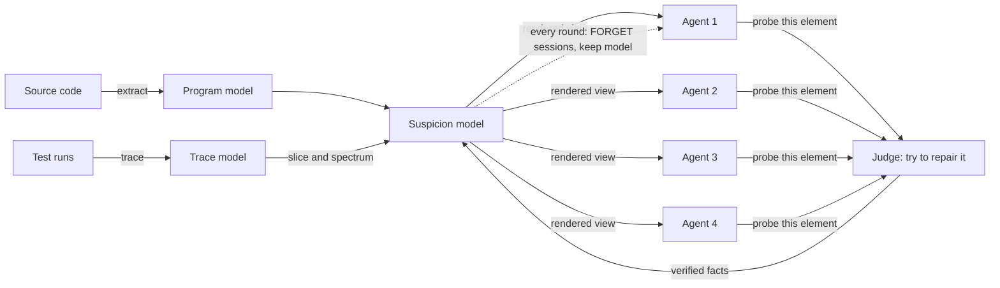

# LETHE: Fault Localization by Forgetting the Story and Keeping the Model

*A worked, runnable example that combines **forgetting** (Tan et al., "Scaling Discovery Requires Forgetting") with **model-driven engineering (MDE)** to localize a bug, compared against a single LLM, parallel LLMs, and a collaborating LLM team.*

---

## 0. TL;DR

- **Problem.** An LLM debugging agent latches onto its first plausible suspect and keeps digging there. Longer sessions make this worse, not better.
- **Idea.** Represent the program as **models** (program model, trace model, suspicion model). Let a **team** of agents propose hypotheses, and let a **judge** verify them by *trying to repair* the program at the suspected place. Periodically **forget**: throw away every agent's session and reasoning, and keep only the **suspicion model** (verified facts: what is exonerated, what is confirmed).
- **Why MDE.** Forgetting needs something compact, typed and diff-able to remember. Models provide exactly that: facts survive, stories do not.
- **Example result (toy, but every probe is a real execution).** On a 12-function shop program with one seeded off-by-one bug, the team with forgetting localizes the faulty line in **11 proposals / 3 rounds**. A single agent needs 13 proposals / 13 rounds, a team without forgetting needs 15 proposals / 4 rounds, and four parallel agents do **not** find it within their 24-proposal budget (Section 5).
- **Important caveat.** The agents in this example are *scripted stand-ins*, not real LLMs (Section 1). The example illustrates the mechanism; it is not evidence about real models.

---

## 1. What is real and what is simulated

| Part of the pipeline | Status |
|---|---|
| Code → program model, test traces → trace model, failure slicing, Ochiai suspiciousness, suspicion model, model diff, model-to-text report | **Real code, executed** |
| The judge (mutation-based "fix-probe") and every probe result | **Real code, executed** (each mutant is run against the full test suite in a subprocess) |
| The "LLM agents" | **Simulated.** A transparent scripted policy that encodes two behaviours reported in the paper: agents are drawn to hypotheses suggested by the failure message, and they become anchored to regions they have already explored |
| Token counts | **Modelled** with a simple formula (cost grows with session length) |

Section 8 shows how to replace the scripted agents with real LLM calls. Section 7 shows how sensitive the outcome is to the one anchoring parameter in the toy policy.

---

## 2. The idea in one picture



**The loop.**

1. **Extract** a program model from the code (components, functions, statements, call edges).
2. **Trace** the tests to get a trace model (which test covers which statement, and who passed or failed). **Slice** it down to what the failing test executed.
3. **Annotate** the program model with a **suspicion model** (spectrum scores now, verified facts later).
4. A **team of agents** each reads the suspicion model, proposes one element to examine, and the **judge** tests that hypothesis by trying single-edit repairs inside the element. Results are written back as facts. Agents see each other's results through the shared model (model diffs, no extra tokens).
5. **Forget** every round: discard all agent sessions (the reasoning and the stories) and restart fresh agents from the suspicion model only.

The design rule behind step 5: **remember facts, forget narratives.** A fact ("no one-edit repair exists in `shipping_fee`") is cheap, checkable and unbiased. A narrative ("I'm sure the bug is around shipping, I just haven't found the right line") is what causes anchoring.

---

## 3. The running example

A tiny shop checkout. The spec for loyalty discounts: 0% under 1 year, 5% for 1 to under 3 years, **10% for 3 or more years**.

### 3.1 The program under test

`shop/catalog.py`

```python
PRICES = {"A": 50.00, "B": 100.00, "C": 19.99}


def price_of(sku):
    return PRICES[sku]
```

`shop/pricing.py`

```python
def loyalty_rate(years):
    """Discount rate for a customer, based on years of membership."""
    if years > 3:
        return 0.10
    if years >= 1:
        return 0.05
    return 0.0


def bulk_rate(total_qty):
    """Extra discount for large quantities."""
    if total_qty >= 10:
        return 0.02
    return 0.0
```

`shop/checkout.py`

```python
from shop.catalog import price_of
from shop.pricing import loyalty_rate, bulk_rate

SHIPPING_FEE = 10.0
FREE_SHIPPING_THRESHOLD = 100.0
REVIEW_THRESHOLD = 200.0
TAX_RATE = 0.0  # prices are tax-inclusive


def round_money(x):
    return round(x + 1e-9, 2)


def subtotal(cart):
    total = 0.0
    for sku, qty in cart:
        total += price_of(sku) * qty
    return total


def shipping_fee(amount):
    if amount >= FREE_SHIPPING_THRESHOLD:
        return 0.0
    return SHIPPING_FEE


def risk_review(amount):
    """Large orders are flagged for manual review (does not change the price)."""
    if amount >= REVIEW_THRESHOLD:
        return "review"
    return "auto"


def apply_coupon(amount, coupon=None):
    if coupon is None:
        return amount
    return amount - coupon


def tax_for(amount):
    return amount * TAX_RATE


def packaging_fee(cart):
    return 0.0


def compute_total(cart, years, coupon=None):
    amount = subtotal(cart)
    qty = sum(q for _, q in cart)
    rate = loyalty_rate(years) + bulk_rate(qty)
    discounted = apply_coupon(amount * (1 - rate), coupon)
    total = discounted + tax_for(discounted) + packaging_fee(cart) + shipping_fee(amount)
    return round_money(total)


def checkout(cart, years):
    amount = subtotal(cart)
    return {"total": compute_total(cart, years), "status": risk_review(amount)}
```

### 3.2 The test suite

```python
from shop.checkout import checkout


def test_new_customer_small_order():
    assert checkout([("A", 1)], 0) == {"total": 60.0, "status": "auto"}

def test_one_year_member():
    assert checkout([("A", 2)], 1) == {"total": 95.0, "status": "auto"}

def test_two_year_member():
    assert checkout([("B", 1)], 2) == {"total": 95.0, "status": "auto"}

def test_one_year_small_order():
    assert checkout([("A", 1)], 1) == {"total": 57.5, "status": "auto"}

def test_two_year_mixed_cart():
    assert checkout([("A", 1), ("C", 2)], 2) == {"total": 95.48, "status": "auto"}

def test_two_year_big_cart():
    assert checkout([("B", 2)], 2) == {"total": 190.0, "status": "review"}

def test_one_year_two_items():
    assert checkout([("A", 1), ("B", 1)], 1) == {"total": 142.5, "status": "auto"}

def test_four_year_member():
    assert checkout([("B", 1)], 4) == {"total": 90.0, "status": "auto"}

def test_five_year_member():
    assert checkout([("A", 2)], 5) == {"total": 90.0, "status": "auto"}

def test_bulk_order():
    assert checkout([("A", 10)], 0) == {"total": 490.0, "status": "review"}

def test_rounding_case():
    assert checkout([("C", 3)], 0) == {"total": 69.97, "status": "auto"}

def test_three_year_member():
    assert checkout([("A", 2), ("B", 1)], 3) == {"total": 180.0, "status": "review"}
```

### 3.3 The failure

```text
test_three_year_member
  checkout([('A', 2), ('B', 1)], years=3)
  expected: {'total': 180.0, 'status': 'review'}
  actual:   {'total': 190.0, 'status': 'review'}
  (11 of 12 tests pass)
```

The total is off by exactly **10.00**, and `SHIPPING_FEE` is also exactly `10.0`. That coincidence is a very natural trap: *"shipping must be charged by mistake."* In fact the customer has exactly 3 years of membership and gets 5% instead of 10% (5% of 200 is 10).

For reference only, the real fault (never shown to the agents) is this one-character bug:

```diff
--- pricing.py (buggy)
+++ pricing.py (fixed)
@@ -2,3 +2,3 @@
     """Discount rate for a customer, based on years of membership."""
-    if years > 3:
+    if years >= 3:
         return 0.10
```

---

## 4. Step by step: building the models and the judge

### Step 1. Source code → program model (model transformation)

A small metamodel (written as dataclasses; in a production setting this would be an Ecore metamodel in EMF):

```python
"""Minimal metamodel (an Ecore-like structure expressed as dataclasses).

Program model:  Component 1..* Function 1..* Statement, Function --calls--> Function
Trace model:    Test --covers--> Statement, Test.outcome
Suspicion model (see suspicion.py): annotations on the program model.
"""
from dataclasses import dataclass, field


@dataclass
class Statement:
    id: str            # "shop/pricing.py:3"
    file: str
    lineno: int
    text: str
    function: str      # id of the owning Function


@dataclass
class Function:
    id: str            # "shop/pricing.py::loyalty_rate"
    name: str
    file: str
    start: int
    end: int
    calls: list = field(default_factory=list)       # ids of called Functions
    statements: list = field(default_factory=list)  # ids of Statements


@dataclass
class Component:
    id: str            # "shop/pricing.py"
    functions: list = field(default_factory=list)


@dataclass
class ProgramModel:
    components: dict = field(default_factory=dict)
    functions: dict = field(default_factory=dict)
    statements: dict = field(default_factory=dict)

    def component_of(self, element_id):
        if element_id in self.components:
            return element_id
        if element_id in self.functions:
            return self.functions[element_id].file
        return self.statements[element_id].file

    def function_of(self, element_id):
        if element_id in self.functions:
            return element_id
        return self.statements[element_id].function


@dataclass
class TraceModel:
    outcome: dict = field(default_factory=dict)   # test -> passed?
    covers: dict = field(default_factory=dict)    # test -> set of Statement ids
```

The transformation **code → model** uses Python's AST:

```python
"""Model transformation #1: source code  ->  program model (via the Python AST)."""
import ast
import os

from lethe.metamodel import Component, Function, ProgramModel, Statement


def extract_model(root, package="shop"):
    model = ProgramModel()
    parsed = {}
    for fname in sorted(os.listdir(os.path.join(root, package))):
        if not fname.endswith(".py") or fname == "__init__.py":
            continue
        rel = f"{package}/{fname}"
        src = open(os.path.join(root, rel)).read()
        parsed[rel] = (src.splitlines(), ast.parse(src))

    # pass 1: components, functions, statements
    for rel, (lines, tree) in parsed.items():
        comp = Component(id=rel)
        model.components[rel] = comp
        for fn in [n for n in tree.body if isinstance(n, ast.FunctionDef)]:
            fid = f"{rel}::{fn.name}"
            func = Function(id=fid, name=fn.name, file=rel,
                            start=fn.lineno, end=fn.end_lineno)
            comp.functions.append(fid)
            model.functions[fid] = func
            doc = ast.get_docstring(fn) is not None
            seen = set()
            for node in ast.walk(fn):
                if not isinstance(node, ast.stmt) or node is fn:
                    continue
                if doc and node is fn.body[0]:      # skip the docstring
                    continue
                if node.lineno in seen:
                    continue
                seen.add(node.lineno)
                sid = f"{rel}:{node.lineno}"
                model.statements[sid] = Statement(
                    id=sid, file=rel, lineno=node.lineno,
                    text=lines[node.lineno - 1].strip(), function=fid)
                func.statements.append(sid)
            func.statements.sort(key=lambda s: model.statements[s].lineno)

    # pass 2: call edges (by simple name resolution)
    by_name = {f.name: f.id for f in model.functions.values()}
    for rel, (_, tree) in parsed.items():
        for fn in [n for n in tree.body if isinstance(n, ast.FunctionDef)]:
            func = model.functions[f"{rel}::{fn.name}"]
            for node in ast.walk(fn):
                if isinstance(node, ast.Call) and isinstance(node.func, ast.Name):
                    callee = by_name.get(node.func.id)
                    if callee and callee not in func.calls:
                        func.calls.append(callee)
    return model
```

Result:

```text
components=3  functions=12  statements=33

call graph:
  subtotal       -> price_of
  compute_total  -> subtotal, apply_coupon, round_money, loyalty_rate, bulk_rate, shipping_fee, packaging_fee, tax_for
  checkout       -> subtotal, compute_total, risk_review
```

### Step 2. Test runs → trace model, then slice

The trace model links each test to the statements it covers. The **failure slice** keeps only statements executed by the failing test.

```python
"""Model transformation #2: test execution  ->  trace model (test --covers--> statement)."""
import importlib
import os
import sys

from lethe.metamodel import TraceModel


def collect_traces(root, program, tests_module="tests_shop"):
    root = os.path.abspath(root)
    sys.path.insert(0, root)
    mod = importlib.import_module(tests_module)
    trace = TraceModel()
    for name in sorted(n for n in dir(mod) if n.startswith("test_")):
        hit = set()

        def tracer(frame, event, arg):
            path = frame.f_code.co_filename
            if not path.startswith(os.path.join(root, "shop")):
                return None
            rel = os.path.relpath(path, root)
            def local(frame, event, arg):
                if event == "line":
                    hit.add(f"{rel}:{frame.f_lineno}")
                return local
            return local

        sys.settrace(tracer)
        try:
            getattr(mod, name)()
            trace.outcome[name] = True
        except AssertionError:
            trace.outcome[name] = False
        finally:
            sys.settrace(None)
        trace.covers[name] = {s for s in hit if s in program.statements}
    sys.path.remove(root)
    return trace


def failure_slice(trace):
    """Model slice: all statements executed by at least one failing test."""
    out = set()
    for t, passed in trace.outcome.items():
        if not passed:
            out |= trace.covers[t]
    return out
```

Result:

```text
tests: 12  failing: ['test_three_year_member']
failure slice: 27 of 33 statements (81% of the program model remains)
statements outside the slice: checkout.py:24 `return SHIPPING_FEE`; checkout.py:31 `return "auto"`; checkout.py:37 `return amount - coupon`; pricing.py:13 `return 0.02`; pricing.py:4 `return 0.10`; pricing.py:7 `return 0.0`
```

### Step 3. Suspicion model (spectrum scores as a starting point)

The suspicion model annotates the program model. Its starting scores come from spectrum-based fault localization (Ochiai). Later it also stores **verified probe results**. The model is deliberately small and independent of how it was produced, so it can be handed to a brand-new agent.

```python
"""The suspicion model: the ONLY artifact that survives a 'forget'."""
from dataclasses import dataclass, field
from math import sqrt

EXONERATION_FACTOR = 0.05


def ochiai(ef, ep, nf):
    denom = sqrt((ef + nf) * (ef + ep))
    return ef / denom if denom else 0.0


@dataclass
class ProbeResult:
    element: str
    fixed: bool
    best_pass: int
    total_tests: int
    n_mutants: int
    test_runs: int
    fixing: list = field(default_factory=list)   # descriptions of fixing mutants


class SuspicionModel:
    """Annotations on the program model.
    base[stmt]   = spectrum score (Ochiai) from the trace model
    probes[elem] = verified facts returned by the judge (never stories, never reasoning)
    """

    def __init__(self, program, trace):
        self.program = program
        failing = [t for t, ok in trace.outcome.items() if not ok]
        passing = [t for t, ok in trace.outcome.items() if ok]
        self.base = {}
        for sid in program.statements:
            ef = sum(sid in trace.covers[t] for t in failing)
            ep = sum(sid in trace.covers[t] for t in passing)
            self.base[sid] = ochiai(ef, ep, len(failing) - ef)
        self.probes = {}

    # ---- queries ---------------------------------------------------------
    def exonerated(self, eid):
        chain = {eid, self.program.function_of(eid), self.program.component_of(eid)}
        return any(e in self.probes and not self.probes[e].fixed and self.probes[e].n_mutants > 0
                   for e in chain)

    def score(self, eid):
        p = self.program
        if eid in p.statements:
            s = self.base[eid]
        elif eid in p.functions:
            s = max((self.base[x] for x in p.functions[eid].statements), default=0.0)
        else:
            s = max((self.score(f) for f in p.components[eid].functions), default=0.0)
        return s * EXONERATION_FACTOR if self.exonerated(eid) else s

    def confirmed_function(self):
        for eid, r in self.probes.items():
            if r.fixed and eid in self.program.functions:
                return eid
        return None

    def confirmed_statements(self):
        return [e for e, r in self.probes.items() if r.fixed and e in self.program.statements]

    # ---- updates (used for communication between agents) -----------------
    def record(self, result):
        self.probes[result.element] = result

    def copy(self):
        c = SuspicionModel.__new__(SuspicionModel)
        c.program, c.base, c.probes = self.program, self.base, dict(self.probes)
        return c

    def merged_with(self, *others):
        c = self.copy()
        for o in others:
            c.probes.update(o.probes)
        return c

    def diff(self, newer):
        """Model differencing: what changed between two suspicion models."""
        out = []
        for eid, r in newer.probes.items():
            if eid not in self.probes:
                out.append(f"+ probe({self.program.functions[eid].name if eid in self.program.functions else eid}): "
                           f"{'FIXED' if r.fixed else ('no fix' if r.n_mutants else 'inconclusive')} (best {r.best_pass}/{r.total_tests})")
        return out
```

Result:

```text
Function-level (max over statements):
rank score  function
1    0.577  checkout.py::risk_review
2    0.378  pricing.py::loyalty_rate
3    0.354  checkout.py::shipping_fee
4    0.302  pricing.py::bulk_rate
5    0.289  checkout.py::tax_for
6    0.289  checkout.py::subtotal
7    0.289  checkout.py::round_money
8    0.289  checkout.py::packaging_fee
9    0.289  checkout.py::compute_total
10   0.289  checkout.py::checkout
11   0.289  checkout.py::apply_coupon
12   0.289  catalog.py::price_of

Statement-level (top 10):
rank score  location / code
1    0.577  checkout.py:30   return "review"
2    0.378  pricing.py:6   return 0.05
3    0.354  checkout.py:23   return 0.0
4    0.316  pricing.py:5   if years >= 1:
5    0.302  pricing.py:14   return 0.0
6    0.289  catalog.py:5   return PRICES[sku]
7    0.289  checkout.py:11   return round(x + 1e-9, 2)
8    0.289  checkout.py:15   total = 0.0
9    0.289  checkout.py:16   for sku, qty in cart:
10   0.289  checkout.py:17   total += price_of(sku) * qty

ground-truth line shop/pricing.py:3 (`if years > 3:`): score 0.289, rank 6-27 of 27 (ties)
```

**What this tells us.** The spectrum ranks `risk_review` first. That function never changes the price at all; it is high only because it is executed by the failing test and almost nothing else. The truly faulty line `if years > 3:` is executed by *every* test, so spectrum scoring cannot separate it from more than 20 other lines. This is the typical situation with a single failing test, and it is where an agent's judgment (and its biases) take over.

### Step 4. The judge: "try to repair it there"

The judge needs to say whether a hypothesis is true without a ground-truth oracle. Here it runs a **fix-probe**: apply every single-edit mutation inside the suspected element (swap a relational operator, change a constant, swap an arithmetic operator), run the **whole** suite for each mutant, and check whether any mutant makes all tests pass.

- Some mutant passes everything → a one-edit repair exists inside this element (strong evidence).
- No mutant passes everything → the element is **exonerated** under a single-fault assumption.
- No mutation site at all → **inconclusive** (the judge is blind there; it never claims exoneration).

```python
"""The judge: a verifier that scores a hypothesis by *trying to fix the program there*.

fix-probe(element): apply every single-site mutation inside the element (relational
operator swaps, constant changes, arithmetic operator swaps), re-run the whole suite
for each mutant, and report whether any mutant makes ALL tests pass.
    fixed=True   -> a one-edit repair exists inside this element (strong evidence)
    fixed=False  -> no one-edit repair exists inside it (it is exonerated under a
                    single-fault assumption)
"""
import ast
import copy
import json
import os
import shutil
import subprocess
import sys
import tempfile
from concurrent.futures import ThreadPoolExecutor

from lethe.suspicion import ProbeResult

HERE = os.path.dirname(os.path.dirname(os.path.abspath(__file__)))
CMP_SWAP = {ast.Gt: ast.GtE, ast.GtE: ast.Gt, ast.Lt: ast.LtE, ast.LtE: ast.Lt,
            ast.Eq: ast.NotEq, ast.NotEq: ast.Eq}
BIN_SWAP = {ast.Add: ast.Sub, ast.Sub: ast.Add, ast.Mult: ast.Div}


def _sites(tree, lineno):
    """Mutation sites on one source line: (walk_index, kind, payload)."""
    out = []
    for i, node in enumerate(ast.walk(tree)):
        if getattr(node, "lineno", None) != lineno:
            continue
        if isinstance(node, ast.Compare) and len(node.ops) == 1 and type(node.ops[0]) in CMP_SWAP:
            out.append((i, "cmp", None))
        elif isinstance(node, ast.BinOp) and type(node.op) in BIN_SWAP:
            out.append((i, "bin", None))
        elif (isinstance(node, ast.Constant) and isinstance(node.value, (int, float))
              and not isinstance(node.value, bool)):
            for new in (node.value + 1, node.value - 1, 0, node.value * 2, node.value / 2):
                if new != node.value:
                    out.append((i, "const", new))
    return out


def generate_mutants(source, lineno):
    tree0 = ast.parse(source)
    mutants = []
    for idx, kind, payload in _sites(tree0, lineno):
        tree = copy.deepcopy(tree0)
        node = list(ast.walk(tree))[idx]
        if kind == "cmp":
            old = type(node.ops[0]).__name__
            node.ops[0] = CMP_SWAP[type(node.ops[0])]()
            desc = f"line {lineno}: {old} -> {type(node.ops[0]).__name__}"
        elif kind == "bin":
            old = type(node.op).__name__
            node.op = BIN_SWAP[type(node.op)]()
            desc = f"line {lineno}: {old} -> {type(node.op).__name__}"
        else:
            desc = f"line {lineno}: constant {node.value} -> {payload}"
            node.value = payload
        ast.fix_missing_locations(tree)
        mutants.append((desc, ast.unparse(tree)))
    return mutants


def run_variant(root, rel_file, new_source):
    tmp = tempfile.mkdtemp(prefix="lethe_")
    try:
        shutil.copytree(os.path.join(root, "shop"), os.path.join(tmp, "shop"),
                        ignore=shutil.ignore_patterns("__pycache__"))
        shutil.copy(os.path.join(root, "tests_shop.py"), tmp)
        with open(os.path.join(tmp, rel_file), "w") as f:
            f.write(new_source)
        env = dict(os.environ, PYTHONPATH=tmp + os.pathsep + HERE, PYTHONDONTWRITEBYTECODE="1")
        out = subprocess.run([sys.executable, "-m", "lethe.runner"], cwd=tmp, env=env,
                             capture_output=True, text=True, timeout=30)
        return json.loads(out.stdout)
    except Exception:
        return {}
    finally:
        shutil.rmtree(tmp, ignore_errors=True)


class Judge:
    def __init__(self, root, program, n_tests):
        self.root, self.program, self.n_tests = root, program, n_tests
        self.cache = {}
        self.sources = {c: open(os.path.join(root, c)).read() for c in program.components}

    def _statement_ids(self, element):
        p = self.program
        if element in p.statements:
            return [element]
        return list(p.functions[element].statements)

    def probe(self, element):
        if element in self.cache:
            return self.cache[element]
        jobs = []
        for sid in self._statement_ids(element):
            st = self.program.statements[sid]
            for desc, src in generate_mutants(self.sources[st.file], st.lineno):
                jobs.append((st.file, desc, src))
        with ThreadPoolExecutor(max_workers=8) as ex:
            results = list(ex.map(lambda j: run_variant(self.root, j[0], j[2]), jobs))
        best, fixing = 0, []
        for (f, desc, _), res in zip(jobs, results):
            n_ok = sum(res.values())
            best = max(best, n_ok)
            if res and all(res.values()):
                fixing.append(desc)
        total = self.n_tests
        r = ProbeResult(element=element, fixed=bool(fixing), best_pass=best,
                        total_tests=total, n_mutants=len(jobs),
                        test_runs=len(jobs) * total, fixing=fixing)
        self.cache[element] = r
        return r
```

Two real probes:

```text
probe(risk_review): mutants=1  suite runs=12  best pass=10/12  fixed=False
probe(loyalty_rate): mutants=24  suite runs=288  best pass=12/12  fixed=True
   fixing mutants: ['line 3: Gt -> GtE', 'line 3: constant 3 -> 2']
```

Note the judge also hands back a **candidate repair** (`>` → `>=`), which is a useful by-product for developers.

---

## 5. The four search strategies, same budget (24 proposals)

### 5.1 How the agent stand-ins behave

Real LLM agents are replaced by a scripted policy (`lethe/simulate.py`, shown below). An agent scores each candidate function as:

```text
belief(e) = suspicion_model_score(e) * (1 + hint(e)) + LAMBDA * (my_failed_probes_in_e's_component)
```

- `hint`: what the agent "notices" in the failure message. All agents are tempted by code in `checkout.py` (the `10.0 = SHIPPING_FEE` coincidence, "totals are computed in compute_total", "float rounding", "sum of prices"). This models the correlated anchors the paper reports for homogeneous agents. **No agent has a hint pointing at `pricing.py`.**
- `LAMBDA` (default 0.25): the **anchoring** effect. Every failed probe in a component raises the agent's belief in the *rest* of that component ("it must be in here somewhere"). This lives in the agent's **session**, so it is erased by forgetting.
- The facts in the suspicion model (exonerated functions) are **not** erased by forgetting.

Once a function is confirmed, the model is **refined** (a model-to-model zoom-in) and the next proposals are statements inside that function.

```python
"""Scripted stand-ins for LLM agents + the four search configurations.

IMPORTANT: the agents here are NOT language models. They are a transparent toy that
encodes two behaviours the 'Scaling Discovery Requires Forgetting' paper reports:
  (1) agents are drawn to hypotheses suggested by the failure message ("hint"), and
  (2) agents become anchored to a region they have already explored ("session
      memory": every failed probe inside a component raises their belief in the
      *rest* of that component by LAMBDA).
The judge, the models, the slicing, the spectrum scores and every probe result are real.
"""
from collections import Counter
from dataclasses import dataclass, field

BASE_TOKENS, TOKENS_PER_PRIOR_TURN = 2000, 600     # modelled cost of one proposal


@dataclass
class Profile:
    name: str
    hints: dict            # function id -> hint strength (what the agent "notices")


class Agent:
    def __init__(self, profile, model, judge, slice_ids, lam):
        self.p, self.model, self.judge, self.slice, self.lam = profile, model, judge, slice_ids, lam
        self.session = Counter()      # component -> failed probes in THIS session (the "story")
        self.session_len = 0
        self.tried = set()            # elements this agent has itself probed (this session)

    # -- what the agent can consider --------------------------------------
    def candidates(self):
        prog, m = self.model.program, self.model
        fn = m.confirmed_function()
        if fn:                                         # zoomed in: statements of the confirmed function
            pool = [s for s in prog.functions[fn].statements if s in self.slice]
        else:
            pool = [f for f in prog.functions if any(s in self.slice for s in prog.functions[f].statements)]
        return [e for e in pool if e not in m.probes]

    def belief(self, e):
        prog = self.model.program
        hint = self.p.hints.get(e, 0.0)
        anchor = self.lam * self.session[prog.component_of(e)]
        return self.model.score(e) * (1 + hint) + anchor

    def propose(self, claimed=()):
        pool = [e for e in self.candidates() if e not in claimed]
        return max(pool, key=lambda e: (round(self.belief(e), 6), e)) if pool else None

    def observe(self, result):
        self.model.record(result)
        if not result.fixed:
            self.session[self.model.program.component_of(result.element)] += 1

    def forget(self, best_model):
        """Discard the session (the story); keep only the verified facts in the best model."""
        self.model = best_model.copy()
        self.session = Counter()
        self.session_len = 0

    def tokens_for_next(self):
        return BASE_TOKENS + TOKENS_PER_PRIOR_TURN * self.session_len


@dataclass
class Outcome:
    name: str
    events: list = field(default_factory=list)       # (step, agent, element, result)
    proposals: int = 0
    steps: int = 0
    tokens: int = 0
    test_runs: int = 0
    fn_found_at: int = None                          # proposal index when a function was confirmed
    localized_at: int = None                         # proposal index when a fixing statement was found
    localized_step: int = None
    final_model: object = None
    carried: list = field(default_factory=list)      # facts handed over at each forget


def _short(prog, e):
    return prog.functions[e].name + "()" if e in prog.functions else prog.statements[e].text


def _step(out, agents, shared, claim_distinct, step, judge):
    """One synchronous step: every agent makes one proposal."""
    claimed, batch = set(), []
    if shared:   # communication: read peers' committed facts before proposing
        merged = agents[0].model.merged_with(*[a.model for a in agents[1:]])
        for a in agents:
            a.model = merged.merged_with(a.model)
    for a in agents:
        e = a.propose(claimed if claim_distinct else ())
        if e is None:
            continue
        claimed.add(e)
        batch.append((a, e))
    for a, e in batch:
        r = judge.probe(e)
        out.tokens += a.tokens_for_next()
        a.session_len += 1
        out.test_runs += r.test_runs
        out.proposals += 1
        a.observe(r)
        prog = a.model.program
        out.events.append((step, a.p.name, _short(prog, e), r))
        if r.fixed and e in prog.functions and out.fn_found_at is None:
            out.fn_found_at = out.proposals
        if r.fixed and e in prog.statements and out.localized_at is None:
            out.localized_at, out.localized_step = out.proposals, step
    return len(batch)


def run(name, base_model, judge, slice_ids, profiles, lam, steps, shared, forget_after=(), early_stop=True):
    out = Outcome(name)
    agents = [Agent(p, base_model.copy(), judge, slice_ids, lam) for p in profiles]
    prev_best = base_model
    for step in range(1, steps + 1):
        n = _step(out, agents, shared, claim_distinct=shared, step=step, judge=judge)
        out.steps = step
        if early_stop and out.localized_at is not None:
            break
        if n == 0:
            break
        if step in forget_after:
            best = agents[0].model.merged_with(*[a.model for a in agents[1:]])
            out.carried.append(prev_best.diff(best))
            prev_best = best
            for a in agents:
                a.forget(best)
            out.events.append((step, "— FORGET —", "sessions discarded; best model kept", None))
    out.final_model = agents[0].model.merged_with(*[a.model for a in agents[1:]])
    return out


def single_profile(prog):
    f = lambda n: next(i for i in prog.functions if i.endswith("::" + n))
    return [Profile("Agent", {f("shipping_fee"): 0.8, f("compute_total"): 0.5})]


def team_profiles(prog):
    f = lambda n: next(i for i in prog.functions if i.endswith("::" + n))
    return [Profile("A1", {f("shipping_fee"): 0.8}),
            Profile("A2", {f("compute_total"): 0.8}),
            Profile("A3", {f("round_money"): 0.8}),
            Profile("A4", {f("subtotal"): 0.8})]


def run_all_configs(base_model, judge, slice_ids, lam=0.25, budget=24):
    prog = base_model.program
    return [
        run("1 agent (continuous session)", base_model, judge, slice_ids,
            single_profile(prog), lam, steps=budget, shared=False),
        run("4 parallel agents (independent)", base_model, judge, slice_ids,
            team_profiles(prog), lam, steps=budget // 4, shared=False),
        run("Team of 4 (communicate, never forget)", base_model, judge, slice_ids,
            team_profiles(prog), lam, steps=budget // 4, shared=True),
        run("Team of 4 + forgetting (LETHE)", base_model, judge, slice_ids,
            team_profiles(prog), lam, steps=budget // 4, shared=True, forget_after=(1, 2, 3, 4, 5)),
    ]
```

### 5.2 Configuration A: one LLM, one continuous session

```text
step agent       proposal (probe target)   verdict
1    Agent       shipping_fee()            no single-edit fix
2    Agent       risk_review()             no single-edit fix
3    Agent       compute_total()           no single-edit fix
4    Agent       tax_for()                 no single-edit fix
5    Agent       subtotal()                no single-edit fix
6    Agent       round_money()             no single-edit fix
7    Agent       packaging_fee()           no single-edit fix
8    Agent       checkout()                inconclusive (no mutation site)
9    Agent       apply_coupon()            no single-edit fix
10   Agent       loyalty_rate()            FIXED  <-- fix found here
11   Agent       return 0.05               no single-edit fix
12   Agent       if years >= 1:            no single-edit fix
13   Agent       if years > 3:             FIXED  <-- fix found here
```

**Reading the trace.** The agent works through all nine functions of `checkout.py` first: nine proposals, none productive, each failure strengthening its belief that the bug is "in the checkout code". It only leaves that component at proposal 10, because nothing else in it is left. The first confirmation arrives at proposal 10, and the fault line at proposal 13, after 13 sequential rounds.

### 5.3 Configuration B: four parallel LLMs, no communication

```text
step agent       proposal (probe target)   verdict
1    A1          shipping_fee()            no single-edit fix
1    A2          risk_review()             no single-edit fix
1    A3          risk_review()             no single-edit fix
1    A4          risk_review()             no single-edit fix
2    A1          risk_review()             no single-edit fix
2    A2          compute_total()           no single-edit fix
2    A3          round_money()             no single-edit fix
2    A4          subtotal()                no single-edit fix
3    A1          tax_for()                 no single-edit fix
3    A2          shipping_fee()            no single-edit fix
3    A3          shipping_fee()            no single-edit fix
3    A4          shipping_fee()            no single-edit fix
4    A1          subtotal()                no single-edit fix
4    A2          tax_for()                 no single-edit fix
4    A3          tax_for()                 no single-edit fix
4    A4          tax_for()                 no single-edit fix
5    A1          round_money()             no single-edit fix
5    A2          subtotal()                no single-edit fix
5    A3          subtotal()                no single-edit fix
5    A4          round_money()             no single-edit fix
6    A1          packaging_fee()           no single-edit fix
6    A2          round_money()             no single-edit fix
6    A3          packaging_fee()           no single-edit fix
6    A4          packaging_fee()           no single-edit fix
```

**Reading the trace.** The four agents have different hints but share the same anchor (all think "checkout"). Because they cannot see each other, they waste proposals: `risk_review()` is probed by three agents in round 1 and `shipping_fee()` three times in round 3. With only 6 proposals each, none reaches `pricing.py`. This is the "parallel agents plateau" behaviour from the paper: more agents, same blind spot.

### 5.4 Configuration C: a collaborating team, no forgetting

Each agent reads its peers' verified results (model diffs) before proposing. No duplicated work, but each agent's own session still biases it toward its own component.

```text
step agent       proposal (probe target)   verdict
1    A1          shipping_fee()            no single-edit fix
1    A2          risk_review()             no single-edit fix
1    A3          round_money()             no single-edit fix
1    A4          subtotal()                no single-edit fix
2    A1          tax_for()                 no single-edit fix
2    A2          compute_total()           no single-edit fix
2    A3          packaging_fee()           no single-edit fix
2    A4          checkout()                inconclusive (no mutation site)
3    A1          apply_coupon()            no single-edit fix
3    A2          loyalty_rate()            FIXED  <-- fix found here
3    A3          bulk_rate()               no single-edit fix
3    A4          price_of()                inconclusive (no mutation site)
4    A1          return 0.05               no single-edit fix
4    A2          if years >= 1:            no single-edit fix
4    A3          if years > 3:             FIXED  <-- fix found here
```

**Reading the trace.** Communication removes the duplicates, and the team reaches `loyalty_rate()` in round 3. But look at round 2: even though `loyalty_rate` had the second-highest spectrum score, all four agents spend round 2 inside `checkout.py` (`tax_for`, `compute_total`, `packaging_fee`, `checkout`). Their own sessions say "stay here". That is the round LETHE saves.

### 5.5 Configuration D: team + forgetting (LETHE)

```text
step agent       proposal (probe target)   verdict
1    A1          shipping_fee()            no single-edit fix
1    A2          risk_review()             no single-edit fix
1    A3          round_money()             no single-edit fix
1    A4          subtotal()                no single-edit fix
1    — FORGET —  sessions discarded; best model kept
2    A1          loyalty_rate()            FIXED  <-- fix found here
2    A2          compute_total()           no single-edit fix
2    A3          bulk_rate()               no single-edit fix
2    A4          tax_for()                 no single-edit fix
2    — FORGET —  sessions discarded; best model kept
3    A1          return 0.05               no single-edit fix
3    A2          if years >= 1:            no single-edit fix
3    A3          if years > 3:             FIXED  <-- fix found here
```

What was handed over at each forget (this is **all** that survived; no reasoning, no hypotheses, no history):

```text
after forget 1, the ONLY thing carried over is the model delta:
   + probe(shipping_fee): no fix (best 7/12)
   + probe(risk_review): no fix (best 10/12)
   + probe(round_money): no fix (best 11/12)
   + probe(subtotal): no fix (best 5/12)
after forget 2, the ONLY thing carried over is the model delta:
   + probe(loyalty_rate): FIXED (best 12/12)
   + probe(compute_total): no fix (best 11/12)
   + probe(bulk_rate): no fix (best 11/12)
   + probe(tax_for): no fix (best 0/12)
```

**Reading the trace.**

- After round 1 the four agents are wiped. They inherit four verified facts: `shipping_fee`, `risk_review`, `round_money`, `subtotal` are exonerated.
- In round 2 the first fresh agent goes **straight to `loyalty_rate()`** and confirms it. It was not anchored on `checkout.py`, because it never lived through round 1.
- Round 3 is the zoom-in: the model is refined to statements of `loyalty_rate`, and one agent confirms `if years > 3:`.

### 5.6 Results side by side

| Configuration | Function confirmed at proposal | Fault line localized at proposal | Wall-clock rounds | Modelled LLM tokens | Judge suite runs |
|---|---|---|---|---|---|
| 1 agent (continuous session) | 10 | 13 | 13 | 72.8k | 888 |
| 4 parallel agents (independent) | — | not found in 24 | 6 | 84.0k | 1116 |
| Team of 4 (communicate, never forget) | 10 | 15 | 4 | 42.6k | 1044 |
| Team of 4 + forgetting (LETHE) | 5 | 11 | 3 | 22.0k | 1008 |

Notes on reading this table:

- **Wall-clock rounds** is where teams shine: agents work simultaneously.
- **Proposals** is a proxy for LLM cost. LETHE needs the fewest (11), even though it uses four agents per round.
- **Modelled tokens** assume each proposal costs `2000 + 600 * (number of earlier proposals in this session)`, so long sessions are more expensive. This is an assumption chosen for illustration, not a measurement.
- **Judge suite runs** are about the same for all configurations (the judge is the dominant fixed cost; each fix-probe re-runs the suite once per mutant). In a real deployment this cost, not just LLM tokens, belongs in the budget.

---

## 6. Step 6: the output a developer sees (model → text)

The final suspicion model is transformed into a report:

```python
"""Model transformation #3: suspicion model  ->  text (a localization report)."""


def to_report(model, tests_total):
    prog = model.program
    lines = []
    fixed = model.confirmed_statements()
    for sid in fixed:
        r, st = model.probes[sid], prog.statements[sid]
        lines.append(f"LOCALIZED  {st.file}:{st.lineno}   `{st.text}`")
        lines.append(f"  evidence: single-edit repair passes {r.best_pass}/{tests_total} tests")
        for m in r.fixing:
            lines.append(f"  candidate repair: {m}")
    exo = [prog.functions[e].name for e, r in model.probes.items()
           if e in prog.functions and not r.fixed and r.n_mutants > 0]
    inc = [prog.functions[e].name for e, r in model.probes.items()
           if e in prog.functions and r.n_mutants == 0]
    lines.append(f"exonerated functions ({len(exo)}): {', '.join(sorted(exo))}")
    if inc:
        lines.append(f"inconclusive (no mutation site): {', '.join(sorted(inc))}")
    return "\n".join(lines)
```

```text
LOCALIZED  shop/pricing.py:3   `if years > 3:`
  evidence: single-edit repair passes 12/12 tests
  candidate repair: line 3: Gt -> GtE
  candidate repair: line 3: constant 3 -> 2
exonerated functions (7): bulk_rate, compute_total, risk_review, round_money, shipping_fee, subtotal, tax_for
```

This matches the real fault (`pricing.py:3`, `>` should be `>=`), and the suggested repair is the true fix. The exonerated list also tells the developer where **not** to look, which is useful information in its own right.

---

## 7. How robust is this? Sensitivity to the anchoring parameter

The toy policy has one knob, `LAMBDA`, the strength of session anchoring. The table shows the number of proposals and rounds needed to localize the fault line.

| Anchoring strength λ | 1 agent | 4 parallel | Team, no forgetting | Team + forgetting |
|---|---|---|---|---|
| 0.0 | 7 proposals / 7 rounds | 21 proposals / 6 rounds | 11 proposals / 3 rounds | 11 proposals / 3 rounds |
| 0.1 | 13 proposals / 13 rounds | not found (24) | 15 proposals / 4 rounds | 11 proposals / 3 rounds |
| 0.25 | 13 proposals / 13 rounds | not found (24) | 15 proposals / 4 rounds | 11 proposals / 3 rounds |
| 0.5 | 13 proposals / 13 rounds | not found (24) | 15 proposals / 4 rounds | 11 proposals / 3 rounds |
| 1.0 | 13 proposals / 13 rounds | not found (24) | 15 proposals / 4 rounds | 11 proposals / 3 rounds |

What this shows, and what it does not:

- **With no anchoring (`LAMBDA = 0`), forgetting gives no benefit** (11 vs 11 proposals), and a single agent is actually cheaper in proposals (7), though slower in rounds. Forgetting helps only when there is something harmful to forget. That is consistent with the paper's mechanism, and it is a useful negative control.
- **With any positive anchoring, the ordering is the same** in this example. But that is a property of the toy policy, not an empirical finding.
- The only way to know whether real LLM debuggers behave this way is to measure it (Section 9, RQ1).

---

## 8. Replacing the scripted agent with a real LLM

The harness stays the same. Only `Agent.propose` changes. The suspicion model is rendered to text (a model-to-text transformation), the LLM chooses what to probe, and the judge still decides what is true.

*Illustrative sketch, not executed in this document:*

```python
class LLMAgent:
    def __init__(self, view, llm):
        self.view, self.llm = view, llm       # view: "structural" | "dataflow" | "history" | "behavioural"
        self.messages = []                    # the session; emptied by forget()

    def propose(self, model, claimed):
        prompt = render_markdown(model, view=self.view, exclude=claimed)
        self.messages.append({"role": "user", "content": prompt})
        reply = self.llm(system=SYSTEM, messages=self.messages)   # expects JSON
        self.messages.append({"role": "assistant", "content": reply})
        return json.loads(reply)["element"]

    def forget(self, best_model):
        self.messages = []                    # discard the story
        self.model = best_model.copy()        # keep only verified facts

SYSTEM = """You are a fault-localization agent. You are given a model of a program,
the failing test, spectrum scores, and VERIFIED facts from a judge (exonerated or
confirmed elements). Choose exactly ONE element to probe next. Prefer elements the
verified facts do not already exclude. Reply as JSON: {"element": "<id>", "why": "<one sentence>"}"""
```

Design choices to evaluate, all enabled by the model-based setup:

- **Different views per agent** (call graph, data-flow slice, change history, state machine) to reduce correlated anchors.
- **Forget schedule**: every round, or triggered by plateau signals (the top-k ranking stops changing, model diffs per round shrink, reasoning length drops).
- **What to keep**: only judge-verified facts (as here), or additionally the best-scoring unverified hypotheses.
- **Zoom-in**: component → function → statement, as the model is refined at each forget.

---

## 9. From toy to paper

### 9.1 Which MDE techniques are used, and where

| MDE technique | Where it appears | Production counterpart |
|---|---|---|
| Metamodel | `metamodel.py` | Ecore metamodels (EMF) |
| Model discovery / reverse engineering (code → model) | `extract.py` | MoDisco, custom parsers |
| Traceability models (test ↔ code element) | `trace.py` | Trace-link metamodels |
| Model slicing | `failure_slice` | Model slicers over program, trace and architecture models |
| Model-to-model transformation (roll-up, refinement/zoom-in) | `suspicion.py` (function and component scores) | ATL, QVT, Henshin, Epsilon (ETL/EOL) |
| Model annotation (suspicion model) | `suspicion.py` | Profile / annotation models |
| Model differencing (agent communication) | `SuspicionModel.diff` | EMF Compare |
| Model-to-text (report, LLM prompts) | `report.py`, Section 8 | Acceleo, Epsilon EGL |
| Constraint checking *(not in the toy)* | future work | OCL invariants as additional judges |

### 9.2 Suggested research questions

- **RQ1 (existence).** Do LLM debugging agents show anchoring (shrinking edits, shrinking reasoning, repeated probing of one region) as sessions grow?
- **RQ2 (effectiveness).** Does LETHE beat a single agent, parallel agents, and a team without forgetting on Top-1/3/5, MAP/MRR and EXAM at equal cost?
- **RQ3 (ablation).** What does the model contribute? Compare model-based views against raw code, and facts-only memory against facts-plus-hypotheses memory.
- **RQ4 (judge quality).** How often does the fix-probe wrongly exonerate (multi-fault bugs, no applicable mutation operator) and how does that affect results?
- **RQ5 (forget policy).** Fixed schedule vs plateau-triggered forgetting.

### 9.3 Evaluation setup

- **Benchmarks:** Defects4J, BugsInPy, and SWE-bench-style issues with known fault locations.
- **Baselines:** SBFL (Ochiai, DStar), mutation-based FL (MUSE, Metallaxis), single LLM agent, parallel agents, team without forgetting.
- **Metrics:** Top-N accuracy, MAP, MRR, EXAM, plus cost in dollars and judge-execution time.

### 9.4 Threats to take seriously

- The paper's tasks have clean scalar verifiers. Fault localization has none, so the judge is both the hardest part and the main threat to validity. The fix-probe here assumes a single fault and one-edit repairs.
- Forgetting can discard useful information; keeping verified facts (not stories) is a design guess that must be tested, not assumed.
- The toy result depends on one behavioural parameter. Real evidence must come from real agents.
- This example is a single small program with a single bug.

---

## 10. Names

### Tool name

**LETHE** (after the river of forgetfulness in Greek myth).
*Backronym:* **L**ocalizing **E**rrors **T**hrough **H**ypothesis **E**rasure.
*Tagline:* "Forget the story. Keep the model."

Alternatives:

| Name | Idea |
|---|---|
| **Palimpsest** | A manuscript scraped clean and rewritten, while the underlying structure remains |
| **Tabula** | *Tabula rasa*: every round starts from a blank slate |
| **AmnesiaFL** | Blunt, memorable, and descriptive |
| **ForgetMeNot-FL** | Playful: it forgets the story but never the facts |

I have not checked these names for existing tools or trademark conflicts. Please search before committing, since "Lethe" in particular may already be used in other software or ML projects.

### Paper title options

1. **LETHE: Fault Localization by Forgetting the Story and Keeping the Model** (recommended)
2. **Debugging Requires Forgetting: Model-Driven Fault Localization with Amnesic LLM Agent Teams** (echoes the source paper's title)
3. **Don't Fall in Love with Your Suspect: Forgetting-Based, Model-Driven Fault Localization**
4. **Remember the Facts, Forget the Story: Model-Driven Multi-Agent Fault Localization**

---

## Appendix A. Driver script and how to run it

Requirements: Python 3.9 or newer (uses `ast.unparse`), no third-party packages. Layout:

```text
lethe_demo/
  shop/            catalog.py  pricing.py  checkout.py     (program under test, contains the bug)
  tests_shop.py                                            (12 tests, 1 fails)
  lethe/           metamodel.py extract.py trace.py suspicion.py judge.py simulate.py report.py runner.py
  run_demo.py                                              (produces every output shown above, into out/)
```

```bash
python run_demo.py        # a few seconds; writes out/*.txt and out/*.md
```

`run_demo.py`:

```python
import difflib, io, os, sys, contextlib
sys.path.insert(0, os.path.dirname(os.path.abspath(__file__)))
from lethe.extract import extract_model
from lethe.trace import collect_traces, failure_slice
from lethe.suspicion import SuspicionModel
from lethe.judge import Judge
from lethe.simulate import run_all_configs
from lethe.report import to_report
from shop.checkout import checkout

ROOT = os.path.dirname(os.path.abspath(__file__))
OUT = os.path.join(ROOT, "out"); os.makedirs(OUT, exist_ok=True)
def w(name, text): open(os.path.join(OUT, name), "w").write(text.rstrip() + "\n")
short = lambda e: e.split("/")[-1]

# ---- step 0: the failure --------------------------------------------------
got = checkout([("A", 2), ("B", 1)], 3)
w("s0_failure.txt", f"test_three_year_member\n  checkout([('A', 2), ('B', 1)], years=3)\n  expected: {{'total': 180.0, 'status': 'review'}}\n  actual:   {got}\n  (11 of 12 tests pass)")

# ---- step 1: program model ------------------------------------------------
prog = extract_model(ROOT)
lines = [f"components={len(prog.components)}  functions={len(prog.functions)}  statements={len(prog.statements)}", "", "call graph:"]
for f in prog.functions.values():
    if f.calls:
        lines.append(f"  {f.name:<14} -> {', '.join(prog.functions[c].name for c in f.calls)}")
w("s1_program_model.txt", "\n".join(lines))

# ---- step 2: trace model + failure slice ------------------------------------
trace = collect_traces(ROOT, prog)
sl = failure_slice(trace)
fails = [t for t, ok in trace.outcome.items() if not ok]
w("s2_trace.txt", f"tests: {len(trace.outcome)}  failing: {fails}\nfailure slice: {len(sl)} of {len(prog.statements)} statements "
  f"({100*len(sl)//len(prog.statements)}% of the program model remains)\nstatements outside the slice: "
  + "; ".join(f"{prog.statements[s].file.split('/')[-1]}:{prog.statements[s].lineno} `{prog.statements[s].text}`" for s in sorted(set(prog.statements) - sl)))

# ---- step 3: suspicion model ----------------------------------------------
sm = SuspicionModel(prog, trace)
fn_rows = sorted(((sm.score(f), f) for f in prog.functions if any(s in sl for s in prog.functions[f].statements)), reverse=True)
t = ["Function-level (max over statements):", f"{'rank':<5}{'score':<7}function"]
for i, (sc, f) in enumerate(fn_rows, 1):
    t.append(f"{i:<5}{sc:<7.3f}{short(f)}")
st_rows = sorted(((sm.base[s], s) for s in sl), key=lambda x: (-x[0], x[1]))
t += ["", "Statement-level (top 10):", f"{'rank':<5}{'score':<7}location / code"]
for i, (sc, s) in enumerate(st_rows[:10], 1):
    t.append(f"{i:<5}{sc:<7.3f}{short(s)}   {prog.statements[s].text}")
truth = "shop/pricing.py:3"
better = sum(1 for sc, s in st_rows if sc > sm.base[truth]); tied = sum(1 for sc, s in st_rows if sc == sm.base[truth])
t += ["", f"ground-truth line {truth} (`{prog.statements[truth].text}`): score {sm.base[truth]:.3f}, "
          f"rank {better+1}-{better+tied} of {len(st_rows)} (ties)"]
w("s3_suspicion.txt", "\n".join(t))

# ---- step 4: judge ------------------------------------------------------------
judge = Judge(ROOT, prog, len(trace.outcome))
j = []
for name in ("risk_review", "loyalty_rate"):
    fid = next(i for i in prog.functions if i.endswith("::" + name))
    r = judge.probe(fid)
    j.append(f"probe({name}): mutants={r.n_mutants}  suite runs={r.test_runs}  best pass={r.best_pass}/{r.total_tests}  fixed={r.fixed}"
             + (f"\n   fixing mutants: {r.fixing}" if r.fixing else ""))
w("s4_judge.txt", "\n".join(j))

# ---- step 5: the four configurations -------------------------------------------
def fmt(o):
    L = [f"### {o.name}", "```text", f"{'step':<5}{'agent':<12}{'proposal (probe target)':<26}verdict"]
    for st, a, e, r in o.events:
        v = "" if r is None else ("FIXED  <-- fix found here" if r.fixed else ("no single-edit fix" if r.n_mutants else "inconclusive (no mutation site)"))
        L.append(f"{st:<5}{a:<12}{e:<26}{v}")
    L.append("```")
    return "\n".join(L)

outs = run_all_configs(sm, judge, sl, lam=0.25, budget=24)
w("s5_runs.md", "\n\n".join(fmt(o) for o in outs))
tbl = ["| Configuration | Function confirmed at proposal | Fault line localized at proposal | Wall-clock rounds | Modelled LLM tokens | Judge suite runs |", "|---|---|---|---|---|---|"]
for o in outs:
    loc = o.localized_at if o.localized_at else f"not found in {o.proposals}"
    fn = o.fn_found_at if o.fn_found_at else "—"
    tbl.append(f"| {o.name} | {fn} | {loc} | {o.steps} | {o.tokens/1000:.1f}k | {o.test_runs} |")
w("s5_summary.md", "\n".join(tbl))
carried = outs[3].carried
w("s5_carried.txt", "\n".join(f"after forget {i+1}, the ONLY thing carried over is the model delta:\n" + "\n".join("   " + x for x in c) for i, c in enumerate(carried)))

# ---- step 6: report ------------------------------------------------------------------
w("s6_report.txt", to_report(outs[3].final_model, len(trace.outcome)))

# ---- ground truth diff -----------------------------------------------------------------
buggy = open(os.path.join(ROOT, "shop/pricing.py")).read().splitlines()
fixed = [l.replace("years > 3", "years >= 3") for l in buggy]
w("s7_truth.txt", "\n".join(difflib.unified_diff(buggy, fixed, "pricing.py (buggy)", "pricing.py (fixed)", lineterm="", n=1)))

# ---- sensitivity ------------------------------------------------------------------------------
rows = ["| Anchoring strength λ | 1 agent | 4 parallel | Team, no forgetting | Team + forgetting |", "|---|---|---|---|---|"]
for lam in (0.0, 0.1, 0.25, 0.5, 1.0):
    os_ = run_all_configs(sm, judge, sl, lam=lam, budget=24)
    cell = lambda o: (f"{o.localized_at} proposals / {o.steps} rounds" if o.localized_at else "not found (24)")
    rows.append(f"| {lam} | " + " | ".join(cell(o) for o in os_) + " |")
w("s8_sweep.md", "\n".join(rows))
print("ok")
```

`lethe/runner.py` (tiny test runner used by the judge's subprocesses):

```python
"""Tiny test runner: returns {test_name: passed?} for every test_* function."""
import importlib
import json
import sys


def run_all(module_name="tests_shop"):
    mod = importlib.import_module(module_name)
    results = {}
    for name in sorted(n for n in dir(mod) if n.startswith("test_")):
        try:
            getattr(mod, name)()
            results[name] = True
        except Exception:
            results[name] = False
    return results


if __name__ == "__main__":
    sys.stdout.write(json.dumps(run_all()))
```

## Appendix B. Reference

Tan, Zhou, Agrawal, Zhang, Chen, Mang, Lee, Jacob, Sen, Dimakis, Zaharia. *Scaling Discovery Requires Forgetting.* (the paper that motivates the forgetting mechanism and the team-with-communication setup used here).
